# Open Power Menu

**A customizable Win+X-style power-user menu for KDE Plasma.**

Open Power Menu brings fast, familiar access to system tools, applications and
power controls to KDE Plasma—alongside the application launcher you already use.
One button, two menus, configurable shortcuts and a layout built around your workflow.

**Customized example:** a shorter root menu with two nested flyouts.

<a href="docs/images/2.1/hero.png">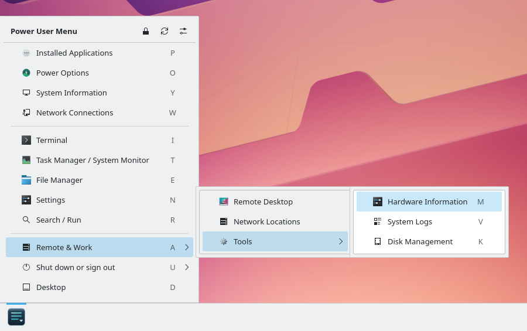</a>

*This example rearranges the default entries and extends Remote & Work with a
nested Tools submenu. [See the actual defaults below](#out-of-the-box-and-make-it-yours).
Click any screenshot for its full-resolution pixels.*

**Version 2.1.0** · [Downloads and release notes](https://github.com/BB7Networks/Open-Power-Menu/releases/tag/v2.1.0).
Historical
[1.0.1](https://github.com/BB7Networks/Open-Power-Menu/releases/tag/v1.0.1),
[RC1](https://github.com/BB7Networks/Open-Power-Menu/releases/tag/v2.1.0-rc1) and
[RC2](https://github.com/BB7Networks/Open-Power-Menu/releases/tag/v2.1.0-rc2) remain available.

[Install](#install-native-21) · [Default vs. customized](#out-of-the-box-and-make-it-yours) · [Launcher](#one-button-two-menus) ·
[Keyboard](#everything-within-reach) · [Appearance](#your-menu-your-style) ·
[Editing](#make-it-yours) · [Power](#power-controls-that-respect-your-choices) ·
[Recovery](#experiment-without-starting-over) · [Technical reference](#built-for-kde-plasma)

## Install native 2.1

Choose the complete **EZ installer** for your distribution, **x86-64**. It
contains the native backend, Configure editor, standalone menu, Plasma widget,
input plugin, icons, desktop integration and reversible installer. An existing
KDE Plasma 6 desktop and matching system libraries are required; no Python,
PySide6 or compiler is needed to run the native installation.

Download the ZIP and its matching checksum from the
[v2.1.0 release](https://github.com/BB7Networks/Open-Power-Menu/releases/tag/v2.1.0).

| Distribution | EZ installer | External checksum |
| --- | --- | --- |
| Manjaro KDE | [OpenPowerMenu-EZ-v2.1.0-Manjaro-x86_64.zip](https://github.com/BB7Networks/Open-Power-Menu/releases/download/v2.1.0/OpenPowerMenu-EZ-v2.1.0-Manjaro-x86_64.zip) | [ZIP SHA-256](https://github.com/BB7Networks/Open-Power-Menu/releases/download/v2.1.0/OpenPowerMenu-EZ-v2.1.0-Manjaro-x86_64.zip.sha256) |
| Debian 13 KDE | [OpenPowerMenu-EZ-v2.1.0-Debian13-x86_64.zip](https://github.com/BB7Networks/Open-Power-Menu/releases/download/v2.1.0/OpenPowerMenu-EZ-v2.1.0-Debian13-x86_64.zip) | [ZIP SHA-256](https://github.com/BB7Networks/Open-Power-Menu/releases/download/v2.1.0/OpenPowerMenu-EZ-v2.1.0-Debian13-x86_64.zip.sha256) |
| Kubuntu 26.04 KDE | [OpenPowerMenu-EZ-v2.1.0-Kubuntu26.04-x86_64.zip](https://github.com/BB7Networks/Open-Power-Menu/releases/download/v2.1.0/OpenPowerMenu-EZ-v2.1.0-Kubuntu26.04-x86_64.zip) | [ZIP SHA-256](https://github.com/BB7Networks/Open-Power-Menu/releases/download/v2.1.0/OpenPowerMenu-EZ-v2.1.0-Kubuntu26.04-x86_64.zip.sha256) |

**Power actions may execute immediately.** New configurations follow KDE's
confirmation preference; upgrades preserve your choice. Select **Always show
confirmation** for built-in Shutdown, Restart and Sign out if you want KDE's
confirmation screen. Explicit custom power commands keep their own behavior.

Download the ZIP and its matching `.sha256` file into the same directory. For
Manjaro, verify the archive **before extracting**, then run as your normal user,
**without sudo**:

```sh
sha256sum -c OpenPowerMenu-EZ-v2.1.0-Manjaro-x86_64.zip.sha256
unzip OpenPowerMenu-EZ-v2.1.0-Manjaro-x86_64.zip
cd OpenPowerMenu-EZ-v2.1.0-Manjaro-x86_64
bash install.sh --check
bash install.sh
```

Use `Debian13` or `Kubuntu26.04` instead of `Manjaro` on those systems. Stop if a
checksum or runtime check fails. The wrapper explains missing dependencies; it
never installs system packages or restarts Plasma. Use the distro's own package
repositories and full-update procedure. Keep the extracted installer for recovery.

**New installation:** right-click the panel → **Add Widgets** → **Open Power Menu
Start Button**. Place OPM on the original launcher's panel and choose that launcher
in Configure. Keep the original applet installed, even when hiding its button.

**Upgrade from 1.0.1, RC1, RC2 or reinstall 2.1.0:** use the same `bash install.sh`
command and retain the existing OPM widget. Configuration, custom commands,
access keys, shortcuts, launcher visibility and panel layout are preserved.
Plasma may cache older widget code until a voluntary sign-out/sign-in; the
installer leaves that decision to you.

| Installation route | When to use it |
| --- | --- |
| **Native EZ ZIP** | Recommended complete user-local installation on a qualified target distro |
| **Native Manjaro package** | Package-manager installation: verify `SHA256SUMS`, run `sudo pacman -U ./open-power-menu-native-2.1.0-1-x86_64.pkg.tar.zst`, then `open-power-menu-native-setup` **without sudo** |
| **Source checkout / GitHub source ZIP** | Developer source; build with [CMake](native/README.md). GitHub's automatic source ZIP is **not** an EZ installer |
| **Separate KDE Store widget** | Frontend only; needs the matching native backend and input plugin. Read [KDE Store integration](docs/KDE-STORE.md) |

[Full installation guide](docs/INSTALLATION.md) · [Binary compatibility](docs/COMPATIBILITY.md) ·
[Rollback and removal](docs/RECOVERY.md)

## Out of the box, and make it yours

| Out of the box — native default configuration | Make it yours — example customized layout |
| --- | --- |
| <a href="docs/images/2.1/menu-default.png">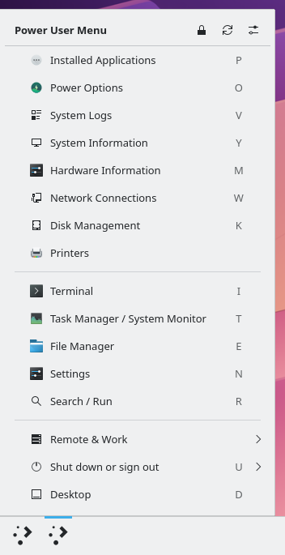</a> | <a href="docs/images/2.1/menu-standard.png"></a> |

**Left:** the binary's unmodified default configuration after installation in
the clean Debian fixture. The original button is visible, OPM adopts its icon,
icons and access-key hints are enabled, and size/density use standard defaults.
Available rows depend on the programs and services installed on your system;
unavailable tools are hidden by default. Upgrades preserve your existing menu.

**Right and the opening hero:** a deliberately customized example. System Logs,
Hardware Information and Disk Management move into a new **Tools** submenu
inside **Remote & Work**, alongside Network Locations. The original button is
hidden, OPM uses its own icon, and built-in power confirmation is set to Always.
These are choices you can make, not the installed defaults.

The appearance comparisons below keep this **customized example layout** fixed
while varying one preference at a time. [Exact default JSON](docs/images/2.1/native-defaults.json)
and [all defaults](docs/FEATURES.md#preferences-and-defaults) are available for reference.

## One button. Two menus

Keep the launcher and favorites you already know. With OPM's default mouse
behavior, **left-click opens your application launcher** and **right-click opens
the Power User Menu**. Meta+X opens or closes the Power User Menu when the shortcut
is available.

| Left-click: your application launcher | Right-click: your system tools |
| --- | --- |
| <a href="docs/images/2.1/launcher-applications.png">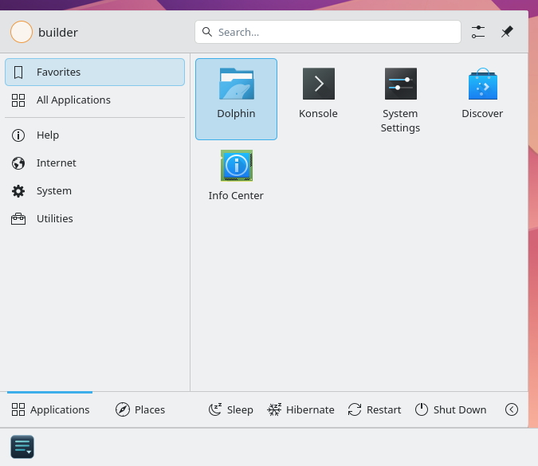</a> | <a href="docs/images/2.1/menu-standard.png"></a> |

The screenshots use Kickoff. Normal Plasma launchers and AppGrid Center have
integration paths; other third-party launchers may need an adapter. In the
widget's Plasma settings, choosing Power User Menu for left-click makes **both
mouse buttons** open OPM. It does not swap left and right actions.

### Put it where you prefer

| Left side | Center | Right side |
| --- | --- | --- |
| <a href="docs/images/2.1/placement-left.png">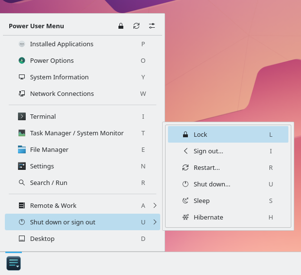</a> | <a href="docs/images/2.1/placement-center.png">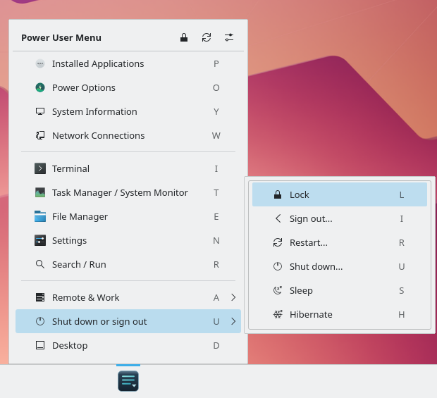</a> | <a href="docs/images/2.1/placement-right.png">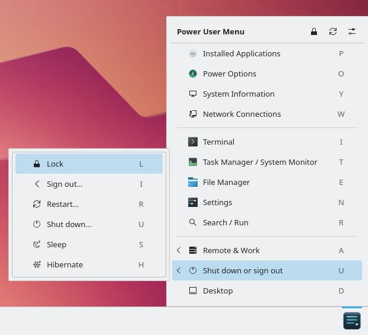</a> |

Flyouts choose the available side, and their arrows follow that direction.
These are cropped regions of separate real 1600×1000 Plasma desktops; the
[manifest](docs/images/2.1/manifest.json) records absolute window positions.

| Original launcher beside OPM | Original button hidden, reversibly |
| --- | --- |
| <a href="docs/images/2.1/launcher-beside.png">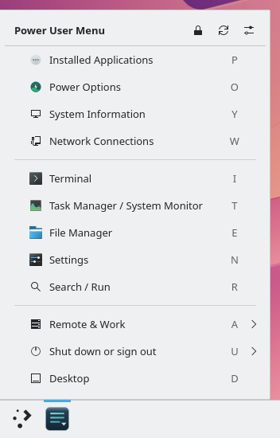</a> | <a href="docs/images/2.1/menu-standard.png"></a> |

| Adopt the launcher's icon | Choose a custom icon |
| --- | --- |
| <a href="docs/images/2.1/launcher-adopted-icon.png">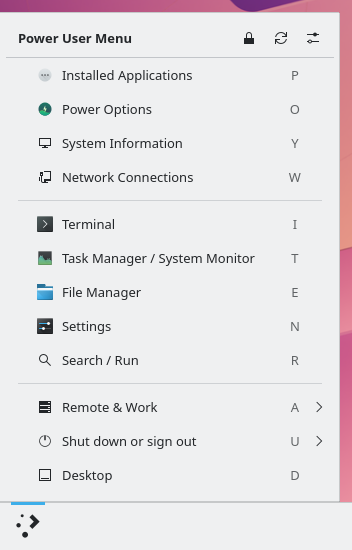</a> | <a href="docs/images/2.1/menu-standard.png"></a> |

Configure accepts a theme icon name or a supported local image. The original
button stays visible by default; hiding it is optional and reversible.

## Everything within reach

Open with **Meta+X**, then use the mouse or keyboard. In a default layout,
**E** opens File Manager, **T** opens Task Manager / System Monitor, and **R**
opens Search / Run. Search / Run hands off to KRunner or another supported
installed runner; it is not a search box inside OPM.

| Key | Action |
| --- | --- |
| Up / Down | Move between available rows |
| Right / Enter | Open a submenu; Enter activates a selected command |
| Left / Escape | Return from a submenu; Escape closes the root menu |
| Assigned letter or digit | Select that entry when access keys are enabled |
| Meta+X | Toggle the widget using Plasma's shortcut system |

The first eligible widget requests Meta+X only if it is free. Change it in the
widget's **Keyboard Shortcuts** settings. Existing assignments and deliberately
cleared bindings are preserved.

### Helpful hints, or a cleaner menu

| Without keyboard hints | With keyboard hints |
| --- | --- |
| <a href="docs/images/2.1/hints-hidden.png">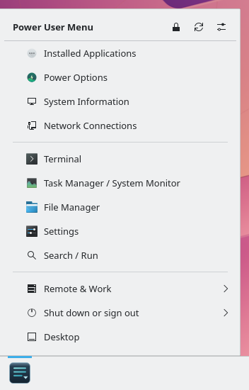</a> | <a href="docs/images/2.1/menu-standard.png"></a> |

**Enable menu access keys** and **Show access-key hints** are separate preferences.
Hiding the letters keeps the keys usable. Disabling access keys suppresses their
hints too, while preserving your saved hint preference. Each entry may have one
A–Z or 0–9 key, or none; assignments are unique within a menu level.

Root and flyout windows share held-key protection. On X11, physical release
evidence prevents a held activation key from selecting a second power action.
For stress tests, use the [private mock fixture](docs/TESTING.md#private-power-and-keyboard-tests),
never a live session-ending action. See the [Wayland limitation](#known-limitations).

## Your menu, your style

Choose the amount of visual detail and spacing that works for you. These
comparisons use the same **customized example** menu content, font, scale and theme unless that is the
setting being compared. The standard view is reused where its settings match.

### Icons: minimal or visual

| Menu icons hidden | Menu icons shown |
| --- | --- |
| <a href="docs/images/2.1/icons-hidden.png">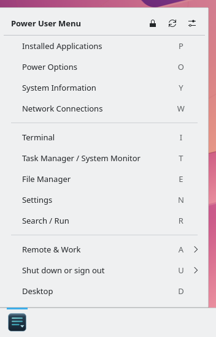</a> | <a href="docs/images/2.1/menu-standard.png"></a> |

Entry icons are on by default. Hiding them does not remove the launcher or
menu-toolbar icons.

| Small icons | Standard icons | Large icons |
| --- | --- | --- |
| <a href="docs/images/2.1/icons-small.png"></a> | <a href="docs/images/2.1/menu-standard.png"></a> | <a href="docs/images/2.1/icons-large.png">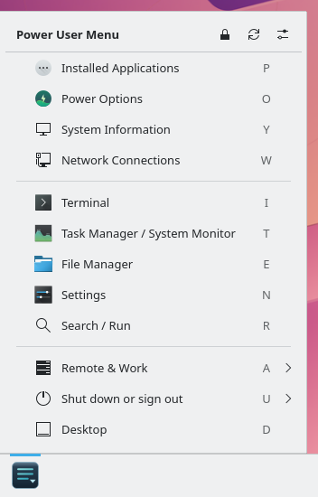</a> |

### Density: more rows or more breathing room

| Compact | Standard | Comfortable |
| --- | --- | --- |
| <a href="docs/images/2.1/density-compact.png">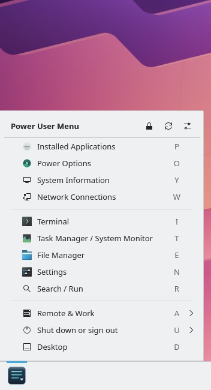</a> | <a href="docs/images/2.1/density-standard.png">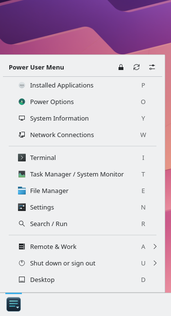</a> | <a href="docs/images/2.1/density-comfortable.png">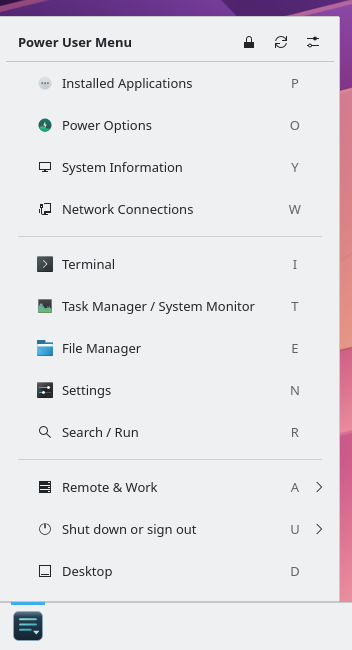</a> |

Density changes row spacing. Text and icon metrics still set a minimum so larger
fonts remain usable. These equal-sized crops make the height difference visible.

### Width and height

| Narrow | Automatic | Wide |
| --- | --- | --- |
| <a href="docs/images/2.1/width-narrow.png">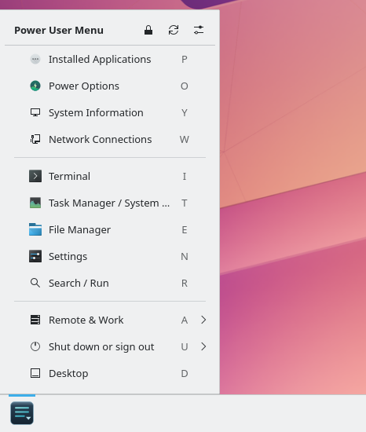</a> | <a href="docs/images/2.1/width-auto.png">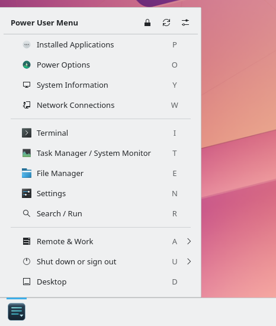</a> | <a href="docs/images/2.1/width-wide.png">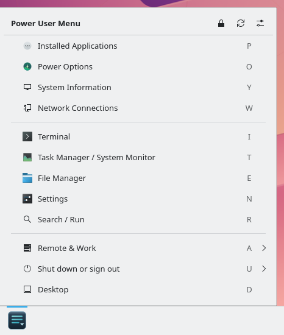</a> |

| Auto-fit height | Custom widget height |
| --- | --- |
| <a href="docs/images/2.1/menu-standard.png"></a> | <a href="docs/images/2.1/height-custom.png">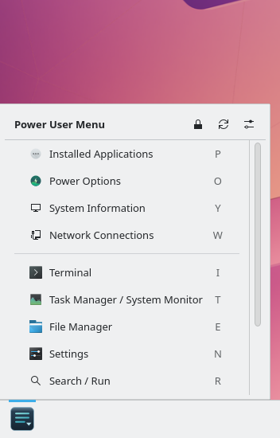</a> |

Automatic width and auto-fit height are the defaults. Custom height remembers
your requested widget height; screen space, font metrics and Plasma constrain
the actual geometry. The standalone menu does not use the widget-height setting.

### Follow KDE, or choose Aero

| Native: Breeze Light | Native: Breeze Dark |
| --- | --- |
| <a href="docs/images/2.1/menu-standard.png"></a> | <a href="docs/images/2.1/native-dark.png">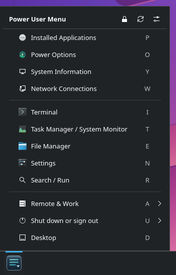</a> |

| Aero Dark | Aero Light |
| --- | --- |
| <a href="docs/images/2.1/aero-dark.png">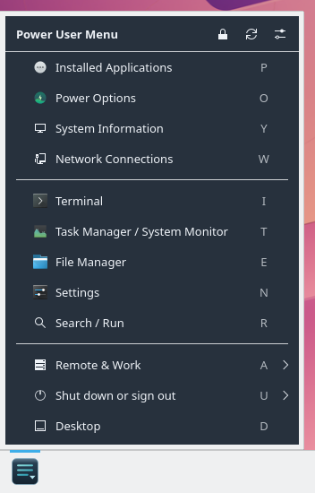</a> | <a href="docs/images/2.1/aero-light.png">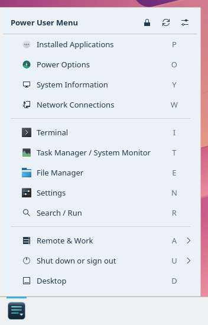</a> |

**Use the desktop theme** follows the system palette. **Aero Dark** and **Aero
Light** are OPM menu appearances; they do not replace your Plasma global theme
or restyle the Configure editor.

## Make it yours

Put the tools you use most at the top. Add installed applications, choose a
built-in command, create a custom program-and-arguments entry, or organize
related work into nested submenus and separators. Change labels, icons and
access keys without replacing your whole menu.

### Rearrange directly in the menu

Select the **lock** icon to unlock the layout. Drag entries, hold over a submenu
to enter it, or use the movement menu. **Go Back** takes you out of a submenu.
Choose **Save layout** to keep the draft or **Cancel** to discard it. Commands
stay inactive while editing; closing the popup retains an unfinished draft.

| Unlock and reorder | Choose a destination | Move inside; Go Back when ready |
| --- | --- | --- |
| <a href="docs/images/2.1/editing-reordered.png">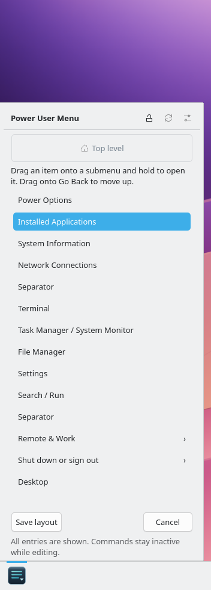</a> | <a href="docs/images/2.1/editing-destination.png"></a> | <a href="docs/images/2.1/editing-submenu.png">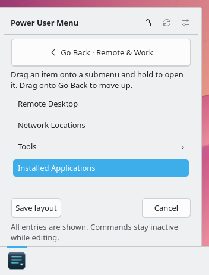</a> |

Keyboard editing is available too: **Alt+Up/Down** reorders, **Alt+Left** moves
out, and **Alt+Right** offers destination submenus. **Menu / Shift+F10** opens
movement commands. The in-menu editor rearranges existing entries; use Configure
to add or change their commands. [Original unlocked view](docs/images/2.1/editing-unlocked.png).

## Configure your menu

Open the **Configure** toolbar button, or run `open-power-menu --edit`. The native
editor has three pages. These captures edit the customized example profile. Its **Save** button applies the draft; ordinary preference
changes need no Plasma restart.

| General | Layout | Backups |
| --- | --- | --- |
| <a href="docs/images/2.1/configure-general.png">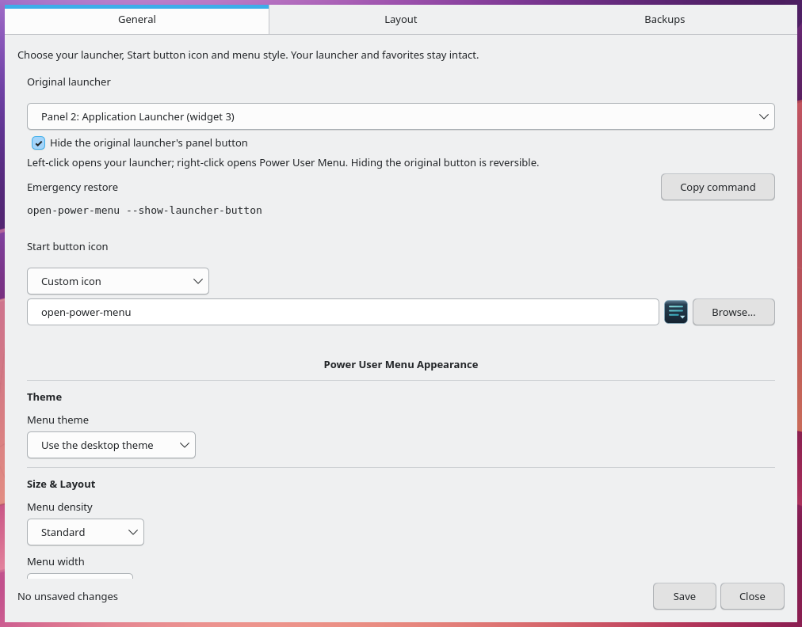</a> | <a href="docs/images/2.1/configure-layout.png">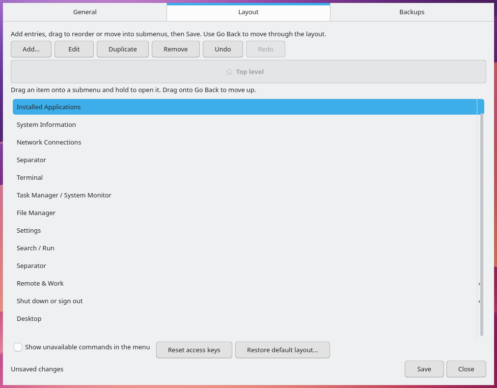</a> | <a href="docs/images/2.1/configure-backups.png">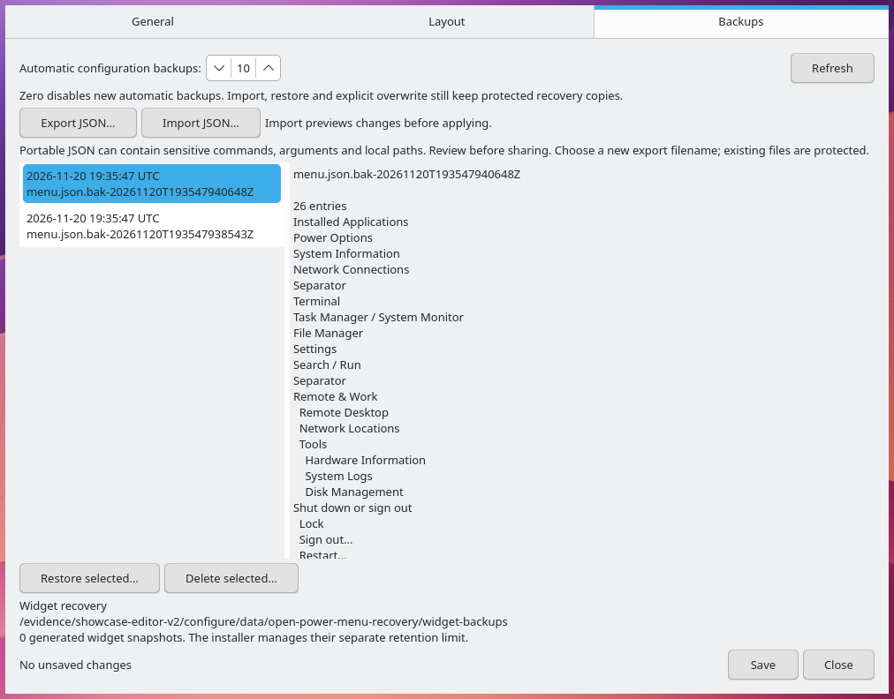</a> |

| Launcher and button | Appearance and dimensions | Keyboard and hover behavior |
| --- | --- | --- |
| <a href="docs/images/2.1/configure-launcher.png">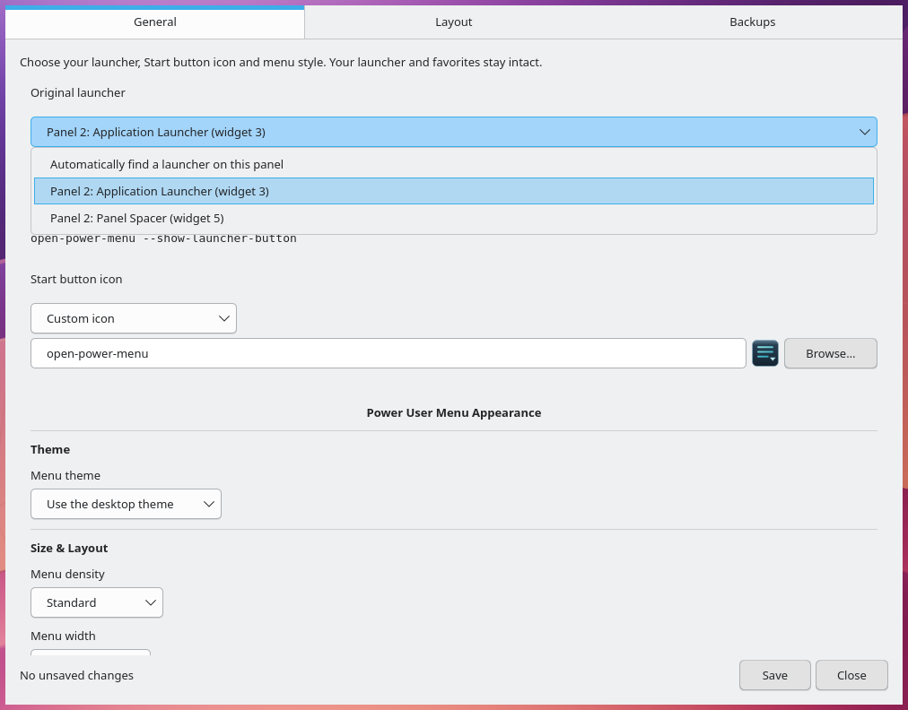</a> | <a href="docs/images/2.1/configure-appearance.png">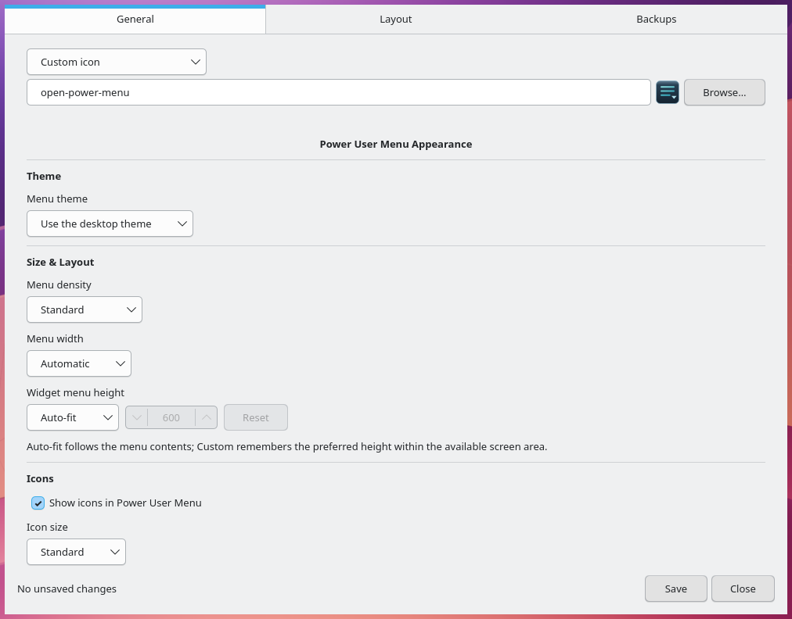</a> | <a href="docs/images/2.1/configure-keyboard-hover.png">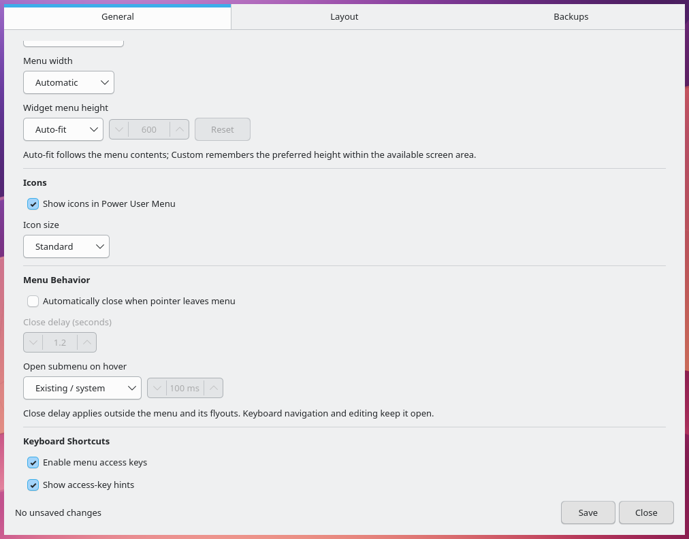</a> |

Automatic pointer-leave dismissal is **off by default**. Enable it to close after
0.5–5 seconds outside the root menu and its flyouts; the initial delay is 1.2
seconds. Keyboard navigation and editing keep it open. Submenu hover can retain
existing/system behavior, open immediately, or wait 100–600 ms. Escape and outside
clicks still dismiss deliberately when automatic closing is disabled.

### Add the right kind of entry

| Built-in command | Installed application |
| --- | --- |
| <a href="docs/images/2.1/configure-builtin.png">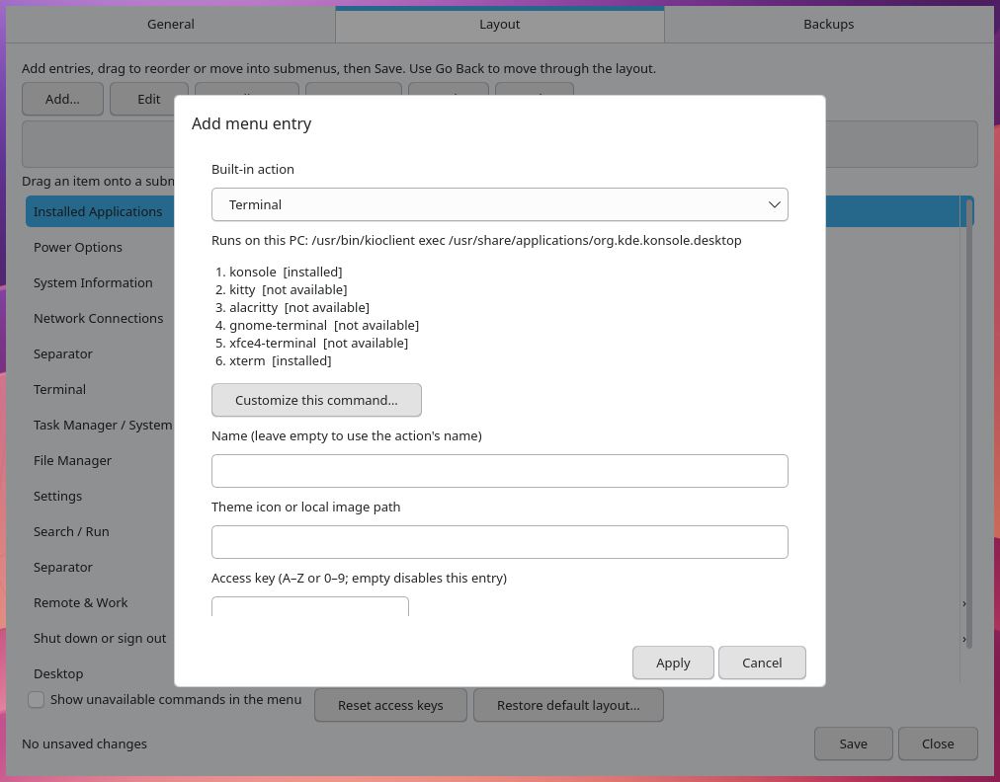</a> | <a href="docs/images/2.1/configure-application.png">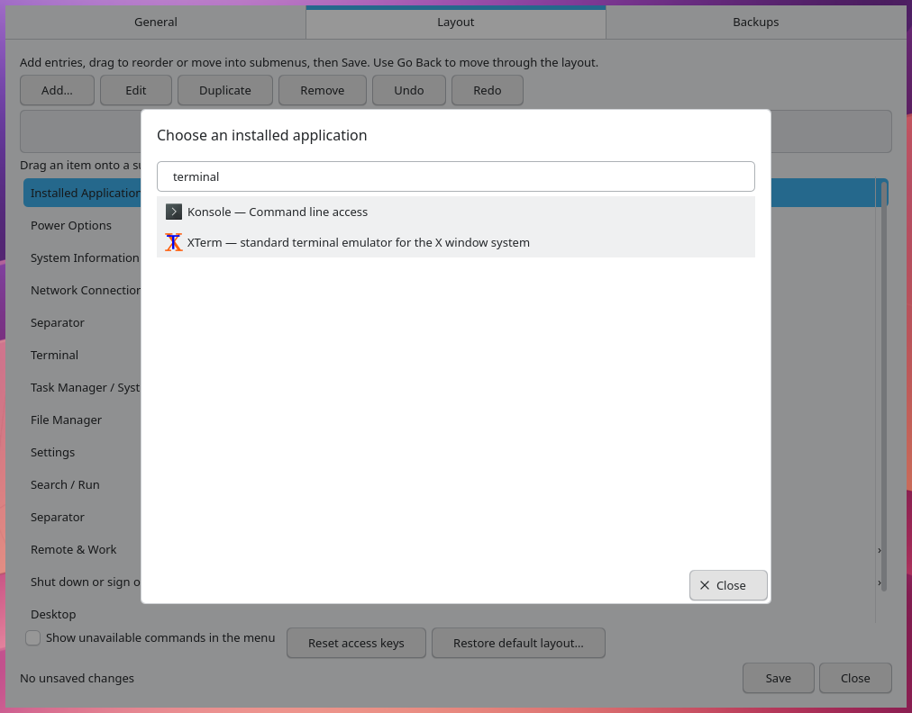</a> |

| Custom program and arguments | Your own submenu |
| --- | --- |
| <a href="docs/images/2.1/configure-custom-command.png">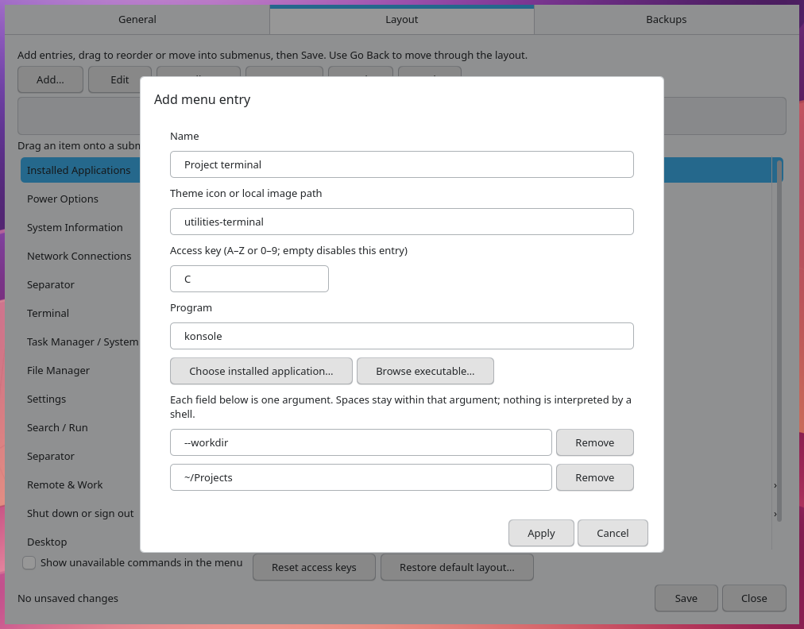</a> | <a href="docs/images/2.1/configure-submenu.png">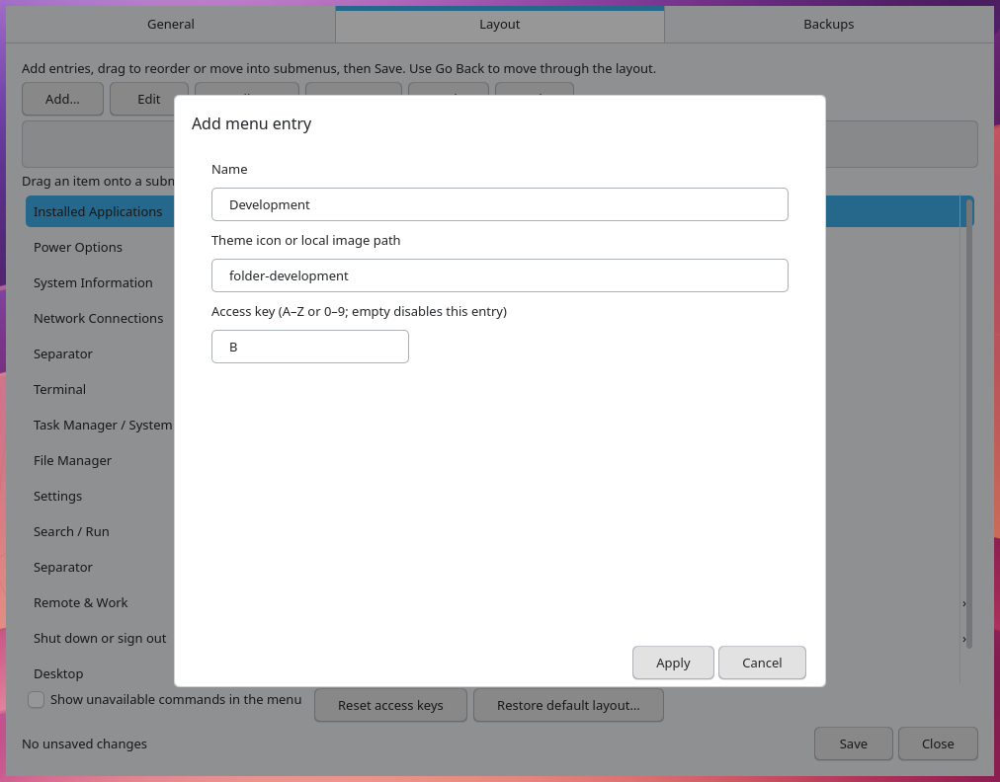</a> |

Built-ins resolve the desktop's preferred applications and supported installed
fallbacks. The application picker handles desktop-entry launch semantics.
Custom commands contain an executable and **individual arguments**; OPM does not
implicitly interpret pipes, `&&` or other shell syntax. An explicitly selected
shell or D-Bus command keeps its own behavior and permissions.

Configure also offers **Duplicate**, **Remove**, **Undo/Redo**, **Reset access
keys**, and **Restore default layout**. It validates concurrent changes and
protects a recovery copy before an explicit overwrite. See the
[complete feature inventory](docs/FEATURES.md) for every setting, accepted value,
new-install default, built-in tool and implementation reference.

## Power controls that respect your choices

The native **Power Actions** dropdown controls built-in Shutdown, Restart and
Sign out. OPM uses KDE's own session services and confirmation interface.

| Policy | What happens |
| --- | --- |
| **Follow KDE system settings — recommended** | Follows KDE's current confirmation preference; default for a new configuration |
| **Always show confirmation** | Requests KDE's native confirmation screen |
| **Execute immediately** | Requests the action without a confirmation step |

<a href="docs/images/2.1/configure-power.png">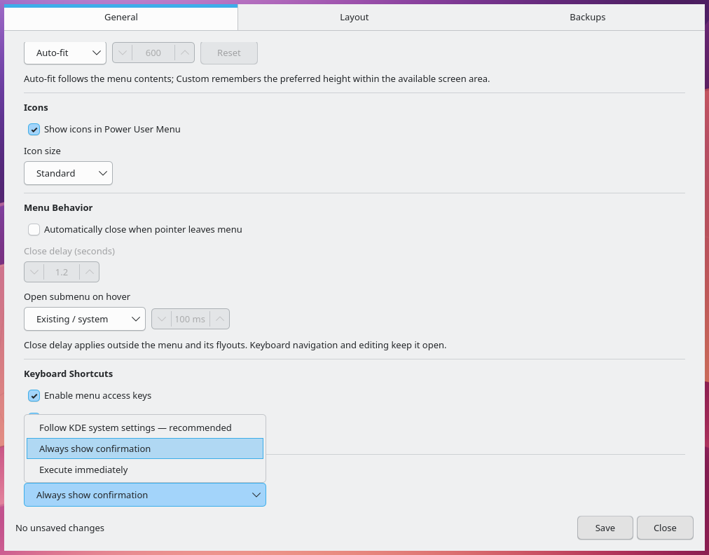</a>

**Upgrades preserve existing preferences.** Saved legacy Boolean choices migrate
to the corresponding always/immediate mode. Existing explicit custom commands
are preserved, too: a direct `org.kde.Shutdown` command can act immediately even
when Always show confirmation is selected. Inspect that entry's type; do not
trigger another live operation to diagnose it.

Sleep, Hibernate and Lock retain their platform-specific handling. Availability,
authorization and sleep inhibitors still apply. Unavailable tools are hidden by
default; Configure → Layout can show them disabled. OPM does not install missing
tools or override KDE policy. [Power behavior and read-only diagnostics](docs/POWER.md).

## Experiment without starting over

Undo/Redo lets you revise a Configure draft. Automatic configuration backups
keep the latest **10** ordinary revisions by default; choose 0–1,000 in Backups.
Zero disables ordinary automatic backups, while protected recovery copies remain.
Preview a backup before restoring it. Import validates a selected JSON file and
previews its contents; export writes the current draft to a new file. Review
personal paths and command arguments before sharing an export.

**Configuration restore and application rollback are separate.** Restoring a
menu changes its configuration. Rolling back an installation restores the
previous complete application, widget and activation files while retaining
personal configuration. Native installation snapshots are not automatically pruned.

From the retained, matching EZ directory, as your normal desktop user:

```sh
bash install.sh --recover    # Recover an interrupted native transaction
bash install.sh --rollback   # Restore the preceding captured installation
```

To restore the original launcher's button without removing anything:

```sh
open-power-menu --show-launcher-button
```

To uninstall, first remove **only the OPM widget** through Plasma so its handler
restores launcher visibility and releases its shortcut. Keep the original
launcher. Then run:

```sh
bash install.sh --uninstall
```

Configuration and recovery history remain. Keep Python/PySide6 while retaining
rollback to 1.0.1; native OPM does not remove those dependencies. The
[recovery guide](docs/RECOVERY.md) covers snapshot locations, cached widget code
and the retained native recovery executable if the wrapper cannot run.

### What an EZ install actually looks like

This is an excerpt from a real **disposable Debian 13** installation of the
approved 2.1.0 source, using the complete native ZIP:

```text
$ sha256sum -c OpenPowerMenu-EZ-v2.1.0-Debian13-x86_64.zip.sha256
OpenPowerMenu-EZ-v2.1.0-Debian13-x86_64.zip: OK
$ bash install.sh --check
Open Power Menu 2.1.0 — Debian 13 KDE Plasma 6 / x86_64
Verified native EZ installer. Application setup runs only for your user.
...
Archive and runtime checks passed. No application files were installed.
$ bash install.sh
...
New user-local installation.
Settings, custom commands, shortcuts and panel layout are preserved.
Power actions may execute immediately. Custom power commands keep their explicit behavior.
Proceed with install? [y/N]: y
...
Installed. For a new setup: panel → Add Widgets → Open Power Menu Start Button.
```

[Complete unedited transcript](docs/images/2.1/ez-transcript.txt) ·
[Installer source/hash provenance](docs/images/2.1/ez-provenance.json).
This demonstration is not a physical hardware acceptance claim.

## Built for KDE Plasma

Native 2.1 uses a **C++/Qt backend**, a **Qt Quick/Kirigami Configure editor**, a
**Plasma QML widget with a native input plugin**, and a **Qt Widgets standalone
menu**. D-Bus connects the widget to the backend. The native installer activates
user-local desktop integration transactionally. Python remains development/test
and historical compatibility tooling, not a requirement of native OPM itself.

### Standalone, when you want it

Run `open-power-menu` to open the standalone menu, or `open-power-menu --edit` for
Configure. The standalone uses the same configuration, built-in actions,
access-key preferences and power policy. It has cursor/corner placement hints;
Wayland controls final window placement. It does not include the Plasma toolbar
or in-menu editor.

<a href="docs/images/2.1/standalone.png">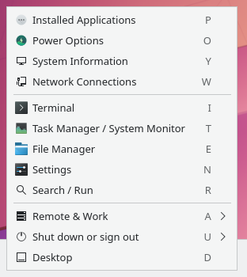</a>

Read-only commands include `open-power-menu --list` and `open-power-menu --check`.
The standalone also accepts `--config`, `--anchor`, `--theme` and
`--default-config`; see [native usage and source builds](native/README.md).

### Compatibility

| Binary target | Qualified runtime snapshot | Boundary |
| --- | --- | --- |
| Manjaro KDE x86-64 | Qt 6.12.0 / Plasma 6.8.2 | Native Wayland session and matching Manjaro libraries; avoid partial Qt/KDE upgrades |
| Debian 13 KDE x86-64 | Qt 6.8.2 / Plasma 6.3.6 | Debian 13 native payload and libraries |
| Kubuntu 26.04 x86-64 | Qt 6.10.2 / Plasma 6.6.7 | Ubuntu 26.04 KDE runtime and native payload |

These are qualified snapshots, not a promise that any older runtime with the
same distro name works. Each distribution builds its own payload and records
exact packages/source identity in `QUALIFICATION.json`. Arch remains a pinned
regression target; there is no public Arch EZ compatibility claim. Other systems
and architectures need their own source build and qualification.

The earlier Manjaro Qt 6.11.2 / Plasma 6.7.5 build is a separate snapshot.
Plasma 6.8 removed its native X11 session. X11 protections remain tested on
pinned Plasma 6.7 and Debian/Kubuntu; the new Manjaro payload targets Wayland.

The widget targets **Plasma 6**. Building the complete native editor requires
**Qt 6.6 or later**, matching KF6 Config/Service, Kirigami and the documented
QML/platform modules; the built binaries require their own distro's runtime.
See [compatibility](docs/COMPATIBILITY.md), [dependencies](docs/INSTALLATION.md)
and [native CMake development](native/README.md).

### Feature and technical reference

| Topic | Reference |
| --- | --- |
| Every setting, allowed value, default and implementation | [Verified feature inventory](docs/FEATURES.md) |
| All 23 built-in tools, preferred applications and access-key presets | [Built-in catalog](docs/FEATURES.md#built-in-tools-and-selection) |
| Configuration location, editing and persistence | [Configuration](docs/CONFIGURATION.md) |
| KDE confirmation, custom power commands and safe diagnostics | [Power behavior](docs/POWER.md) |
| Import/export, configuration history, rollback and removal | [Recovery](docs/RECOVERY.md) |
| Runtime targets and physical acceptance boundaries | [Compatibility](docs/COMPATIBILITY.md) |
| Tests, isolated keyboard seats and private power services | [Testing](docs/TESTING.md) |
| Current architecture and source-build instructions | [Native development](native/README.md), [architecture](docs/architecture/0001-native-runtime.md) |
| Screenshot settings, exact source and reproducible capture | [Showcase provenance](docs/SHOWCASE.md), [image inventory](docs/images/2.1/image-inventory.csv) |
| Historical Python implementation and previous release documentation | [History](docs/history/README.md) |

## Troubleshooting

| Symptom | First checks |
| --- | --- |
| Widget does not appear | Verify successful installation and search Add Widgets for **Open Power Menu Start Button**. Keep the original launcher. Cached QML may need a voluntary sign-out/sign-in. |
| Backend unavailable / Configure will not open | Run `open-power-menu --check`, then consult [session and runtime diagnostics](docs/TROUBLESHOOTING.md). Rerun the complete matching installer if components are missing; the menu's refresh button retries the backend. |
| Meta+X reaches an obsolete widget | Inspect Plasma Keyboard Shortcuts, clear an obsolete binding and assign the current applet. OPM does not overwrite an existing assignment. |
| A command is missing | Check that its tool/service is installed and available. Enable **Show unavailable commands in the menu** to inspect disabled entries. |
| Confirmation seems ignored | Check whether the entry is a native built-in or an explicit custom command. Read [Power behavior](docs/POWER.md); do not repeat a real power operation as a test. |
| Another editor changed the configuration | Keep your draft, reload, or review the explicit overwrite/recovery choice. Avoid replacing the JSON manually. |
| Need the previous application or menu | Use application rollback or Configure → Backups respectively; they are separate histories. |

[Detailed troubleshooting](docs/TROUBLESHOOTING.md) · [Recovery](docs/RECOVERY.md)

## Known limitations

- **X11 translucent-panel ghosting:** a faint last menu row may remain behind an
  affected panel until redraw. This cosmetic issue remains deferred; it has not
  been claimed fixed by the new gallery.
- **X11 responsiveness:** minor responsiveness differences remain under review.
  The previously verified popup-collapse and Meta+X reopening corrections are preserved.
- **Wayland release observation:** if a physical key release occurs outside OPM
  and cannot be established, a destructive selection fails closed. Virtual tests
  cannot certify physical compositor shortcuts, activation tokens or placement.
- **Distribution boundaries:** use the matching native payload and libraries.
  Display scaling, third-party launchers, GPU/compositor behavior and physical
  panel layouts still need workstation acceptance.
- **Acceptance scope:** the owner reported successful Manjaro EZ installation
  and normal menu/Configure use. That does not establish real power-action or
  physical held-key safety. The Kubuntu held-I test interference was diagnosed;
  a separate X11 opening-focus timeout remains unresolved. See
  [qualification and limitations](docs/TESTING.md).

The new screenshots are actual native UI from **Debian 13, Plasma 6.3.6, Qt
6.8.2, X11/Xvfb + KWin, 100% scale**. Power-service endpoints are private mocks.
They demonstrate the product and its settings, not physical hardware validation.
The [historical side-by-side gallery](docs/images/README.md) remains available
with its original filenames and pixels.

## Contributing and license

[Report an issue](https://github.com/BB7Networks/Open-Power-Menu/issues) with your
source/version, distribution, Plasma/Qt versions, X11/Wayland session, launcher,
settings and reproduction steps. Review logs for personal paths and custom
commands before sharing them.

Start with [contributing](docs/CONTRIBUTING.md), [tests](docs/TESTING.md) and the
[current documentation index](docs/README.md). The [publishing guide](docs/PUBLISHING.md)
keeps release qualification and explicit approval separate from development.
Legacy 1.0.1 material is preserved for history, compatibility testing and rollback;
new native installations should never use its Python installer.

Independent community project; not affiliated with KDE. **MIT license:** [LICENSE](LICENSE).
