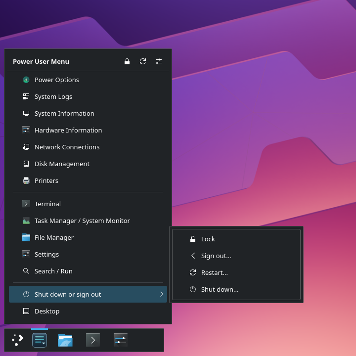
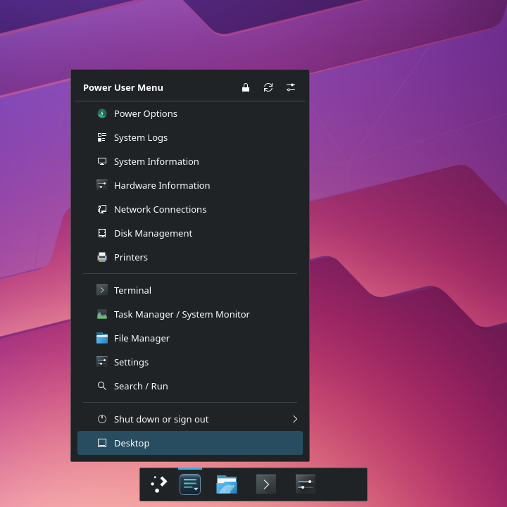
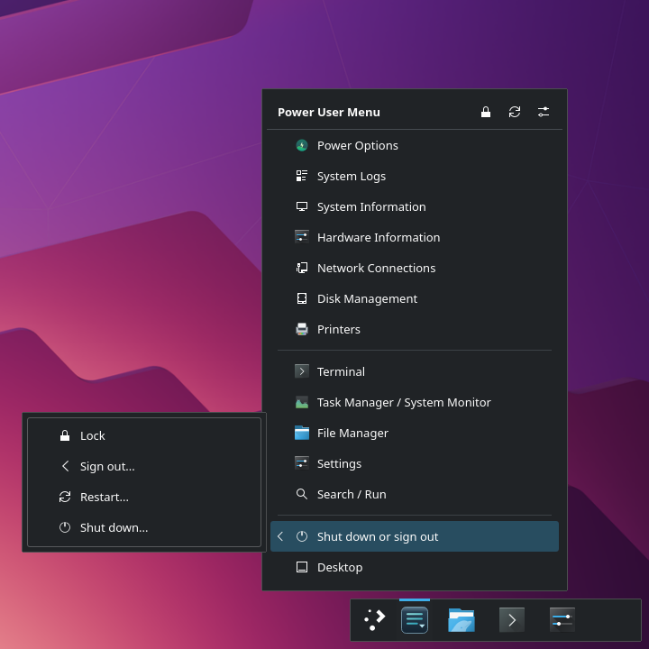

# Open Power Menu

**Native 2.1.0 is in stable-release preparation.** Phase 1 is approved; repository
cleanup is under review. Physical acceptance and final publication approval are
still required. Stable 1.0.1 and the historical RC releases remain unchanged.
Use the [native installation guide](docs/INSTALLATION.md) and matching
distribution-specific EZ package. The source checkout's root scripts only explain
installation; they do not install the legacy Python application.

**Warning: Shutdown, Restart and Sign out can execute immediately.** New installs
follow KDE's confirmation setting; upgrades preserve the existing choice.
Configure offers **Always show confirmation** for built-in power entries.
Explicit custom commands retain their own behavior. Perform power and held-key tests only with the private mocks
described in the release notes. Physical acceptance is required before final 2.1.0.

**One launcher button. Two useful menus.**

The Windows right-click Start / Win+X menu is a good idea. Microsoft has made
some questionable decisions over the years, but this is one worth keeping.
Open Power Menu (OPM) brings that workflow to **KDE Plasma 6**, alongside the
application launcher you already like.

| On the OPM launcher button | What happens |
| --- | --- |
| **Left-click** | Opens your existing application launcher |
| **Right-click** | Opens the Power User Menu |
| **Meta+X**, when available | Opens or closes the Power User Menu |

Keep your favorites, launcher and panel. OPM adds quick access to system tools
without insisting on an entire desktop makeover.

The native backend, Configure editor and standalone menu require no Python
runtime or compiler. See [compatibility](docs/COMPATIBILITY.md) for the three
qualified binary targets and [current documentation](docs/README.md).

## See it in action

The existing gallery is retained from earlier releases; the native 2.1 gallery
refresh is a separately reviewed documentation phase.

| Left side | Center | Right side |
| --- | --- | --- |
| <a href="docs/images/menu-left.png"></a> | <a href="docs/images/menu-center.png"></a> | <a href="docs/images/menu-right.png"></a> |

**Power User Menu** — Quick access to system tools and applications.
**Submenus** — Organized commands with adaptive flyouts.

[Open the full-size gallery](docs/images/README.md) for launcher and configuration views.

## Make it yours

- **Keep your launcher.** Use Kickoff, Kicker or a supported alternative such as
  AppGrid Center. Optionally hide its original panel button, reversibly.
- **Organize your tools.** Add installed applications, commands, separators and
  nested submenus. Flyout arrows follow the side on which each submenu opens.
- **Edit in place.** Unlock the menu, drag entries and use **Go Back** to move
  through submenus. Save when ready or cancel your draft.
- **Choose the appearance.** Follow your desktop theme or use Dark Aero, choose
  the launcher button icon, and show or hide menu entry icons.
- **Close automatically if you prefer.** An optional setting closes the menu
  after the configured delay when the pointer leaves it and its submenus. It stays open during
  keyboard navigation and layout editing.
- **Recover confidently.** Configuration backups, Undo/Redo and restore controls
  help you experiment without manually editing JSON files.

## Install

Use the complete native EZ ZIP for **Manjaro KDE**, **Debian 13 KDE** or
**Kubuntu 26.04**, x86-64. It includes the backend, editor, standalone, widget,
native input plugin and reversible installer. Match your distribution and
verify the external checksum before extracting. Run as your desktop user,
**without sudo**, inside the extracted EZ directory:

```sh
bash install.sh --check
bash install.sh
```

The same command upgrades 1.0.1, RC1, RC2 or reinstalls 2.1.0 while preserving
configuration, shortcuts, launcher selection and recovery history. Keep the
existing applet for upgrades. For a new setup, add **Open Power Menu Start Button**
through Plasma's Add Widgets and select the original launcher in Configure.
Never remove the original launcher.

Read [downloads, checksums and installation](docs/INSTALLATION.md),
[runtime compatibility](docs/COMPATIBILITY.md), and [rollback](docs/RECOVERY.md).
System dependencies are checked and explained; the EZ wrapper does not install
them automatically or restart Plasma. Native code uses the distro Qt/KDE runtime.

A **Code → Download ZIP** archive is source, not an EZ installer. Developers use
[the native CMake build](native/README.md). Legacy Python installation machinery
is retained only for compatibility tests under `legacy/1.0.1/`.
The separate `.plasmoid` needs its matching native backend and plugin; see
[KDE Store information](docs/KDE-STORE.md).

## Everyday use

Left-click for your familiar application launcher; right-click for system tools.
Hover a submenu to open its flyout, or use the arrow keys and Enter. Escape
closes the menu. **Meta+X** uses KDE's native widget shortcut when the combination
is available; change it in the widget's Keyboard Shortcuts settings.

**Desktop**, at the bottom of new/default menus, toggles KDE's native Show
Desktop action to reveal the desktop or restore your windows. Add it through
Configure → Layout → Built-in command if you have an existing custom menu.
Unavailable tools are hidden by default; OPM does not install them for you.

To rearrange entries, select the **lock** icon to unlock editing. Drag a row,
hold it over the center of a submenu to enter, then use the full-width **Go Back**
strip to move out. Choose **Save layout** or **Cancel**. Closing the popup keeps
an unfinished draft for your next visit. Right-click an entry for movement
commands; Configure → Layout also offers Duplicate and Undo/Redo.

The **refresh** icon reloads an open menu and retries the backend if it was
unavailable. Opening the menu normally already refreshes its contents.
See [editing and keyboard controls](docs/CONFIGURATION.md).

## Configure your menu

| Tab | What you can change |
| --- | --- |
| **General** | Launcher selection, original-button visibility, button icon, appearance, menu icons and automatic closing |
| **Layout** | Applications, built-in tools, custom commands, submenus, separators and their order |
| **Backups** | Configuration history, restoration and widget upgrade snapshots |

**Show icons in Power User Menu** is enabled by default. Turning it off reclaims
space in menu rows while keeping launcher and toolbar icons visible.
**Automatically close when pointer leaves menu** is off by default.

Custom commands run with your usual permissions. Enter an executable and its
arguments, such as `dolphin ~/Documents`; shell operators such as pipes and `&&`
are not interpreted. The installed-application picker handles desktop entries
for you. See [configuration, backups and recovery](docs/RECOVERY.md).

## Quick troubleshooting

- **Widget missing:** check that setup finished successfully and search Add
  Widgets for **Open Power Menu Start Button**. If needed, log out and back in
  locally; avoid doing this while remote desktop is your only access.
- **Backend unavailable:** run `~/.local/bin/open-power-menu --check`. If the
  backend or dependencies are missing, rerun the complete installer, then refresh.
- **Meta+X opens an old instance:** clear the obsolete widget binding in System
  Settings → Keyboard → Shortcuts, then assign the current widget's shortcut.
- **Need an earlier menu:** open Configure → Backups → Manage / Restore Backups.
  Restore validates the selected version and keeps a recovery copy first.

If the original launcher button was hidden, restore it with:

```bash
~/.local/bin/open-power-menu --show-launcher-button
```

To uninstall, remove only the OPM widget, then run `bash install.sh --uninstall` from the
retained native EZ directory. Your original launcher, configuration and recovery history
remain. See [recovery and removal](docs/RECOVERY.md).

## Compatibility and contributing

OPM targets KDE Plasma 6 on Linux. Native launchers and AppGrid Center use
separate integration paths; other third-party launchers may need an adapter.
Display scaling, panel placement and compositor behavior can vary by desktop.

[Report a bug](https://github.com/BB7Networks/Open-Power-Menu/issues) with your
distribution, Plasma/Qt versions, launcher and steps to reproduce it.
Contributors can start with [contributing](docs/CONTRIBUTING.md),
[testing](docs/TESTING.md), [native development](native/README.md), and
[publication preparation](docs/PUBLISHING.md). The
[architecture decisions](docs/architecture/0001-native-runtime.md) and
[development history](docs/history/README.md) distinguish current native behavior
from earlier Python and migration milestones.

Independent community project, not affiliated with KDE. **MIT license:** [LICENSE](LICENSE).
