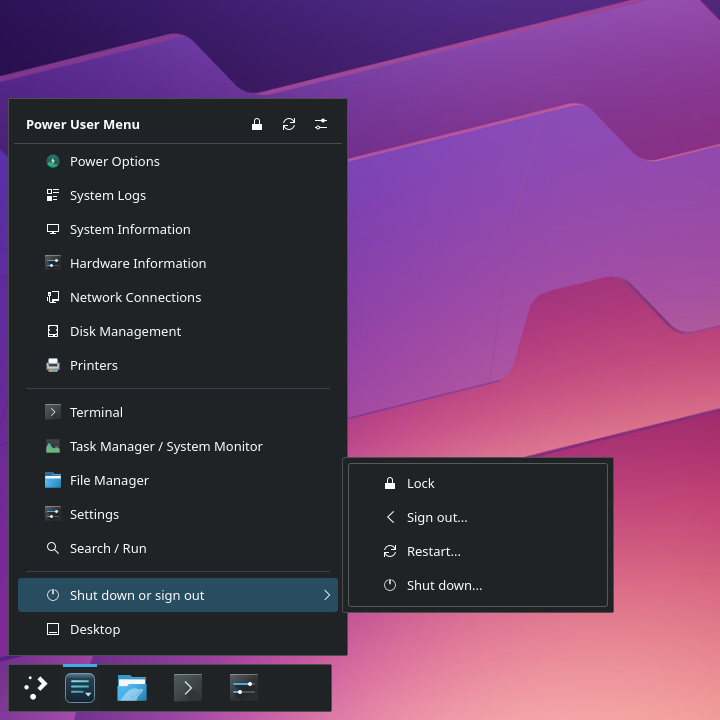
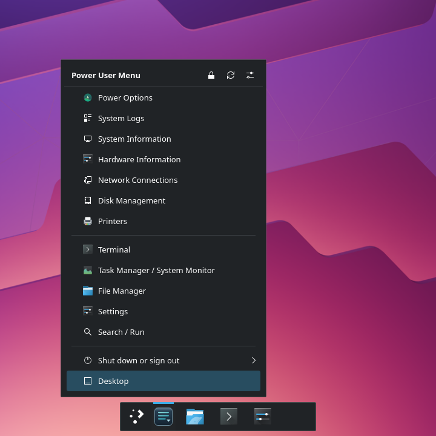
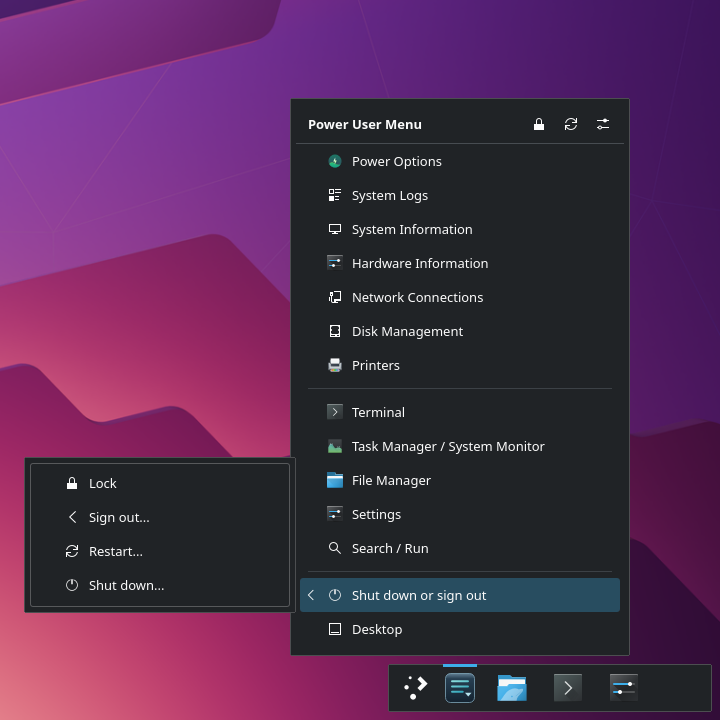

# Open Power Menu

**One launcher button. Two useful menus.**

The Windows right-click Start / Win+X menu is a good idea. Microsoft has made
some questionable decisions over the years, but this is one worth keeping.
Open Power Menu (OPM) brings that workflow to **KDE Plasma 6**, alongside the
application launcher you already like.

| On the OPM launcher button | What happens |
| --- | --- |
| **Left-click** | Opens your existing application launcher |
| **Right-click** | Opens the Power User Menu |
| **Meta+X**, when available | Opens or closes the Power User Menu |

Keep your favorites, launcher and panel. OPM adds quick access to system tools
without insisting on an entire desktop makeover.

**Version 1.0.1** is the first public release of Open Power Menu.
Download the complete installer from [GitHub Releases](https://github.com/BB7Networks/Open-Power-Menu/releases),
or install directly from the source repository. See the
[release review and compatibility notes](docs/RELEASE-1.0.1.md).

## See it in action

| Left side | Center | Right side |
| --- | --- | --- |
| <a href="docs/images/menu-left.png"></a> | <a href="docs/images/menu-center.png"></a> | <a href="docs/images/menu-right.png"></a> |

**Power User Menu** — Quick access to system tools and applications.
**Submenus** — Organized commands with adaptive flyouts.

[Open the full-size gallery](docs/images/README.md) for launcher and configuration views.

## Make it yours

- **Keep your launcher.** Use Kickoff, Kicker or a supported alternative such as
  AppGrid Center. Optionally hide its original panel button, reversibly.
- **Organize your tools.** Add installed applications, commands, separators and
  nested submenus. Flyout arrows follow the side on which each submenu opens.
- **Edit in place.** Unlock the menu, drag entries and use **Go Back** to move
  through submenus. Save when ready or cancel your draft.
- **Choose the appearance.** Follow your desktop theme or use Dark Aero, choose
  the launcher button icon, and show or hide menu entry icons.
- **Close automatically if you prefer.** An optional setting closes the menu
  1.2 seconds after the pointer leaves it and its submenus. It stays open during
  keyboard navigation and layout editing.
- **Recover confidently.** Configuration backups, Undo/Redo and restore controls
  help you experiment without manually editing JSON files.

## Install

You need **KDE Plasma 6**, Python 3, PySide6 (QtCore, QtDBus and QtWidgets) and
`kpackagetool6`. Run the installer as your normal desktop user, **without sudo**.

1. Download **OpenPowerMenu-EZ-v1.0.1.zip** from [Releases](https://github.com/BB7Networks/Open-Power-Menu/releases).
2. Extract the entire ZIP and open a terminal inside the extracted
   `OpenPowerMenu-v1.0.1` directory.
3. Run:

   ```bash
   bash install.sh
   ```

4. Right-click your Plasma panel → **Add Widgets**. Add **Open Power Menu Start
   Button** to the same panel as your existing launcher.
5. Right-click OPM and select the **settings icon**. In General, choose your
   launcher and test both mouse buttons before optionally hiding its original button.

If PySide6 is missing on Manjaro, setup asks before using the system package
manager. It never silently installs packages or restarts Plasma.

**Installing from source instead:** choose **Code → Download ZIP** on this
repository, extract the entire archive, and run `bash install.sh` in it.
If you already use Git:

```bash
git clone https://github.com/BB7Networks/Open-Power-Menu.git
cd Open-Power-Menu
bash install.sh
```

**Upgrading:** extract the newer complete package and run `bash install.sh`
again. Your saved menu, launcher settings and recovery history are preserved.

The separate `.plasmoid` download contains only the widget. It does **not**
install the Python backend; use the complete EZ installer for a working setup.
See [KDE Store information](docs/KDE-STORE.md).

## Everyday use

Left-click for your familiar application launcher; right-click for system tools.
Hover a submenu to open its flyout, or use the arrow keys and Enter. Escape
closes the menu. **Meta+X** uses KDE's native widget shortcut when the combination
is available; change it in the widget's Keyboard Shortcuts settings.

**Desktop**, at the bottom of new/default menus, toggles KDE's native Show
Desktop action to reveal the desktop or restore your windows. Add it through
Configure → Layout → Built-in command if you have an existing custom menu.
Unavailable tools are hidden by default; OPM does not install them for you.

To rearrange entries, select the **lock** icon to unlock editing. Drag a row,
hold it over the center of a submenu to enter, then use the full-width **Go Back**
strip to move out. Choose **Save layout** or **Cancel**. Closing the popup keeps
an unfinished draft for your next visit. Right-click an entry for movement
commands; Configure → Layout also offers Duplicate and Undo/Redo.

The **refresh** icon reloads an open menu and retries the backend if it was
unavailable. Opening the menu normally already refreshes its contents.
See [editing and keyboard controls](docs/IN-MENU-EDITING.md).

## Configure your menu

| Tab | What you can change |
| --- | --- |
| **General** | Launcher selection, original-button visibility, button icon, appearance, menu icons and automatic closing |
| **Layout** | Applications, built-in tools, custom commands, submenus, separators and their order |
| **Backups** | Configuration history, restoration and widget upgrade snapshots |

**Show icons in Power User Menu** is enabled by default. Turning it off reclaims
space in menu rows while keeping launcher and toolbar icons visible.
**Automatically close when pointer leaves menu** is off by default.

Custom commands run with your usual permissions. Enter an executable and its
arguments, such as `dolphin ~/Documents`; shell operators such as pipes and `&&`
are not interpreted. The installed-application picker handles desktop entries
for you. See [configuration, backups and recovery](docs/EDITOR-RECOVERY.md).

## Quick troubleshooting

- **Widget missing:** check that setup finished successfully and search Add
  Widgets for **Open Power Menu Start Button**. If needed, log out and back in
  locally; avoid doing this while remote desktop is your only access.
- **Backend unavailable:** run `~/.local/bin/open-power-menu --check`. If the
  backend or dependencies are missing, rerun the complete installer, then refresh.
- **Meta+X opens an old instance:** clear the obsolete widget binding in System
  Settings → Keyboard → Shortcuts, then assign the current widget's shortcut.
- **Need an earlier menu:** open Configure → Backups → Manage / Restore Backups.
  Restore validates the selected version and keeps a recovery copy first.

If the original launcher button was hidden, restore it with:

```bash
~/.local/bin/open-power-menu --show-launcher-button
```

To uninstall, remove only the OPM widget, then run `bash uninstall.sh` from the
complete package. Your original launcher, configuration and recovery history
remain. See [recovery and removal](docs/EDITOR-RECOVERY.md).

## Compatibility and contributing

OPM targets KDE Plasma 6 on Linux. Native launchers and AppGrid Center use
separate integration paths; other third-party launchers may need an adapter.
Display scaling, panel placement and compositor behavior can vary by desktop.

[Report a bug](https://github.com/BB7Networks/Open-Power-Menu/issues) with your
distribution, Plasma/Qt versions, launcher and steps to reproduce it.
Contributors can start with [contributing](docs/CONTRIBUTING.md),
[testing](docs/TESTING.md), [adapters](docs/ADAPTERS.md),
[shortcut troubleshooting](docs/NATIVE-SHORTCUT-CASCADE.md) and
[release preparation](docs/PUBLISHING.md).

The v2.0 development branch introduces a [native Qt backend, configuration editor and standalone menu](native/README.md).
See the [architecture and dependency review](docs/architecture/0001-native-runtime.md)
and [migration status](docs/architecture/native-migration-status.md) for completed
work, physical desktop gates and the remaining installation milestone. The
released 1.0.1 installation still uses Python/PySide6.

Independent community project, not affiliated with KDE. **MIT license:** [LICENSE](LICENSE).
