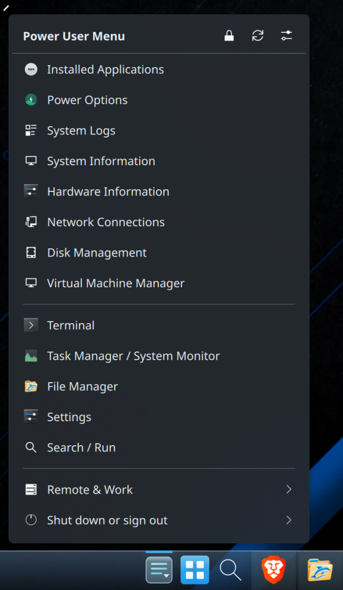
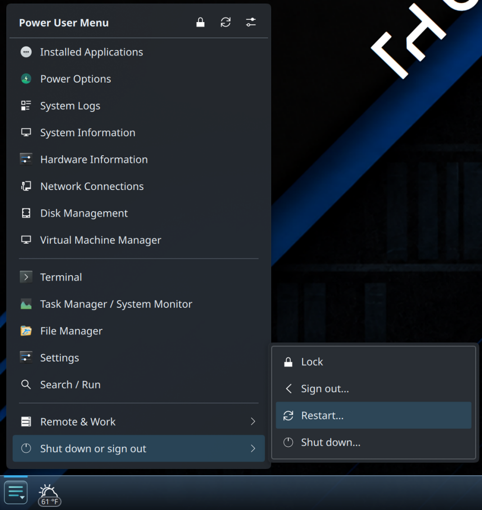
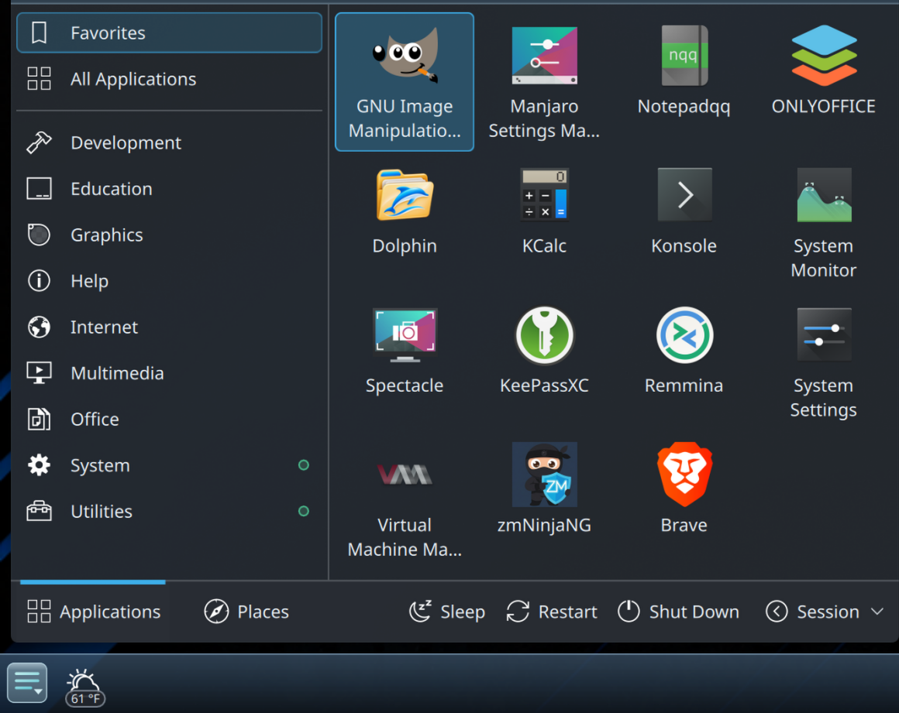

# Open Power Menu

**One launcher button. Two useful menus.**

The Windows right-click Start / Win+X menu is a good idea. Microsoft has made
some questionable decisions over the years, but this is one worth keeping.
Open Power Menu (OPM) brings that workflow to **KDE Plasma 6**, alongside the
application launcher you already like.

| Use the OPM launcher button | What happens |
| --- | --- |
| **Left-click** | Opens your existing launcher—Kickoff, Kicker, or a supported alternative |
| **Right-click** | Opens the configurable, panel-attached Power User Menu |
| **Meta+X** (when available) | Opens or closes that same Power User Menu through the widget's native KDE shortcut |

OPM started during a personal KDE desktop customization project: keep a useful,
familiar workflow without recreating Windows wholesale. It is **not another
application launcher**. Keep your favorites, launcher and panel. OPM adds the
right-click tools without insisting on an entire desktop makeover.

> **Development version · 0.4.17.** The current source includes
> improvements beyond the last development baseline; **no GitHub release has
> been published yet**. Manjaro / Plasma 6 and AppGrid Center 1.9.6 have been
> exercised on a live Wayland desktop. New widget shortcut and in-menu editing
> behavior still require the [desktop acceptance checks](docs/TESTING.md)
> before a new public beta release.

## Screenshots

**Power User Menu** — Quick access to system tools and applications.



**Submenus** — Organized commands with adaptive flyouts.



**Your launcher** — Keep your familiar applications and favorites.



[View the gallery](docs/images/README.md).

## Why use it?

- **One button, both menus.** Keep your preferred application launcher and
  add quick access to system tools, settings, apps and shortcuts.
- **Original launcher stays yours.** Optionally hide *only its panel button*,
  reversibly, without touching favorites or launcher configuration. Native
  Kickoff/Kicker and AppGrid Center 1.9.6 have separate integration paths.
- **A menu you can make your own.** Add built-in commands, installed apps,
  custom commands, nested submenus and separators. Normal-use submenus open
  beside their parent rows as native Plasma flyouts. Arrows follow the side
  each flyout opens on, including nested submenus.
- **Edit without window juggling.** Unlock the menu, drag entries in place,
  hold over a submenu to enter it, and use the large **Go Back** drop area
  to navigate out. **Save layout** or **Cancel**; commands stay inactive
  while you are editing.
- **Useful recovery controls.** Configure has **General**, **Layout** and
  **Backups** tabs, with Duplicate, Undo/Redo, revision checks and backups.
- **A proper user install.** OPM installs for your user account, preserves
  an existing menu on upgrade, and includes an emergency launcher-restore
  command.

**Built-ins adapt to what's actually installed.** For example, **System Logs**
prefers KSystemLog; otherwise it can open the current boot's warning-and-higher
journal in Konsole or XTerm (up to 1,000 lines initially), subject to your
normal journal permissions and installed dependencies. **Printers** prefers
KDE Print Manager when its configuration module is available, then
`system-config-printer`. Neither tool is silently installed for you.
New defaults can include Printers; existing custom menus are not rewritten.

## Install on KDE Plasma 6

1. Get the complete **EZ installer ZIP** from
   [Releases](https://github.com/BB7Networks/Open-Power-Menu/releases)
   when available, or clone/download the source. Extract the complete archive.
2. Open a terminal **inside that directory** and run:

   ```bash
   bash install.sh
   ```

   Run as your **normal desktop user, without `sudo`**. Setup checks for
   Python 3, `kpackagetool6` and PySide6 (QtCore, QtDBus and QtWidgets).
   On Manjaro it can offer, with your permission, to install the system
   `pyside6` package.
3. In Plasma, right-click your panel → **Add Widgets** and add
   **Open Power Menu Start Button** to the panel with your existing launcher.
4. Open **Configure → General**, choose the launcher to use (or let OPM
   find one on the panel), test left- and right-click, then optionally
   hide the original launcher's button.

Verify the backend:

```bash
~/.local/bin/open-power-menu --check
```

**Upgrading:** Run the newer package's `bash install.sh` again.
Your `~/.config/open-power-menu/menu.json` is preserved, and the installer
maintains widget recovery snapshots under
`~/.local/share/open-power-menu-recovery/widget-backups/` (five newest by
default). To retain more, use
`OPM_WIDGET_BACKUP_RETENTION=10 bash install.sh` (valid range: 1–1,000).
Existing snapshots are migrated safely and survive uninstall. The installer
does **not** automatically restart Plasma—particularly important over remote
desktop.

The installer wrappers use separate core scripts in `scripts/`. Source and
complete release archives may be handled on Windows, but running OPM requires
**Linux with Plasma 6**.

> **KDE Store note:** A `.plasmoid` package installs the widget **only**, not
> OPM's Python/PySide6 backend. It isn't a complete one-click installation.
> Use the full installer until the [Store setup path](docs/KDE-STORE.md) is ready.

## Everyday use and layout editing

Normal-use submenus are real flyouts; the editor deliberately works differently.
To rearrange your menu, right-click OPM and select its **lock** icon to unlock
editing. Drag a row to reorder it. Keep holding over the **center of a submenu**
for roughly 450 ms and the full submenu opens **in the same window**—no
second editing window or native cross-window pointer grab.

Inside a submenu, the **full-width Go Back strip** at the top is both a click
target and a drag-hover target. Keep holding an item over it to move back to
the parent level, then drop where you want. It reads **Top level** when you're
already at the root. The editor supports multi-level moves, scrolling while
dragging, and safe cancellation.

Other ways to work: right-click an entry or press **Shift+F10** for movement
actions; **Alt+Arrow** supports keyboard movement. Configure → Layout also
provides **Duplicate**, **Ctrl+Z** to undo, and **Ctrl+Shift+Z** or
**Ctrl+Y** to redo. Entire submenus move with their children.

Changes remain in a draft until **Save layout**. **Cancel** discards them.
Closing the panel popup preserves an unfinished draft for your next visit.
A conflicting external edit is detected rather than silently overwritten.
See [editing and keyboard controls](docs/IN-MENU-EDITING.md) and
[the native shortcut / Go Back notes](docs/NATIVE-SHORTCUT-CASCADE.md).

## Native Meta+X shortcut

Each newly added OPM widget **attempts to register Meta+X once** using KDE's
native widget shortcut API. It opens the *panel-attached* Power User Menu,
not the standalone diagnostic window. Press it again to close the menu.

- An already-occupied combination is **not taken** from another application.
- If you change or deliberately clear the shortcut, ordinary Plasma restarts
  or reinstalling OPM **do not reassign it**.
- When you remove an OPM widget, the new cleanup path releases **that
  instance's** shortcut; choosing Plasma's **Undo** attempts to restore it.
  Live remove/re-add testing is still part of PR #6's acceptance work.
- An orphaned binding left by an **older** OPM instance may need to be
  cleared once in **System Settings → Keyboard → Shortcuts**.
- You can change or disable the current instance's binding in its native
  **Keyboard Shortcuts** settings.

If Meta+X opens a menu at an old panel location, check for a stale
`plasmashell: activate widget …` binding before troubleshooting the menu's
geometry. The older standalone **Application shortcut** route still exists
for diagnostics; it isn't OPM's native default.
See [shortcut lifecycle and testing](docs/NATIVE-SHORTCUT-CASCADE.md) or the
[standalone diagnostic guide](docs/SHORTCUT-APPGRID-DIAGNOSTICS.md).

## Configure your menu

**General** controls the launcher association, reversible hiding of its
original panel button, the OPM button icon, and the menu's appearance.
You can follow the original launcher's icon or use a custom theme icon/image.
Optional Aero styling is available; the normal desktop theme remains a choice.
Uncheck **Show icons in Power User Menu** for compact text-only entries in the
menu and all submenus. The launcher button and toolbar keep their icons, and
turning the option back on restores your existing entry icons.

**Layout** lets you add installed applications, built-ins, custom commands and
submenus. Under **Add → Installed application**, search by name or description;
OPM fills in the proposed name, icon and launch command for review. On KDE,
it prefers `kioclient6` so the desktop file controls activation, terminal
handling, working directory and field-code expansion. Selecting a
**Built-in command** shows the commands and ordered fallbacks available on
that workstation. **Customize this command** creates an independent copy
without changing the built-in's fallback logic.

For a custom command, enter the executable and arguments—for example
`dolphin ~/Documents` or `tool "two words"`. Quoting matters for spaces.
OPM executes argument arrays, **not a shell**: pipes, redirection,
`&&` and command substitution are not interpreted. For terminal output,
launch a terminal explicitly. Commands run with your normal permissions;
they aren't silently elevated.

**Backups** keeps 10 previous automatic **configuration** versions by
default (configurable 0–1,000); a zero limit disables future automatic
backups without deleting previous history. Pruning occurs only after a
successful save. Manually named backups are retained separately. Choose
**Manage / Restore Backups…** to preview and restore a validated version;
the current configuration is first saved as a recovery copy. Backup
deletion asks for confirmation, protects the active configuration and
warns again for recovery copies.

Widget installation snapshots are **separate** from configuration backups.
The Backups tab shows their directory and current count. Unsaved Configure
changes trigger **Save / Discard / Cancel** before closing. For detailed
backup retention, conflict handling and rollback, see
[editor and recovery](docs/EDITOR-RECOVERY.md).

## Recovery and removal

Lost the original launcher button? There is a way back, no treasure map required:

```bash
~/.local/bin/open-power-menu --show-launcher-button
```

The widget applies that reversible preference on its next refresh. OPM never
removes the underlying launcher or edits your panel's favorites.

To uninstall, remove **only the OPM widget** from your panel, then run
`bash uninstall.sh` from the complete extracted package. Your configuration
and backups remain in `~/.config/open-power-menu/`; widget recovery snapshots
remain under `~/.local/share/open-power-menu-recovery/`.
See [recovery and removal](docs/EDITOR-RECOVERY.md) for details.

## Compatibility, development and what comes next

Requires KDE Plasma 6, Python 3, PySide6 and a user D-Bus session. Native
Kickoff/Kicker and AppGrid Center use separate adapters; some third-party
full-screen launchers may need their own. Portable/offscreen tests **cannot
prove** physical Wayland pointer behavior, shortcut registration, popup
placement or focus handling.

Current priorities include live acceptance on more panel positions, launchers,
display scales and clean-account upgrades, plus a
user-consented backend installation path for KDE Store. Separate desktop
application scopes will be evaluated only with real Plasma/systemd evidence—
process ancestry alone doesn't establish an application lifetime.

For contributors:

```bash
python3 -m pip install pytest
python3 -m pytest -q -ra
bash scripts/build-release.sh
```

Python and Node run portable tests; a separate CI job runs optional offscreen
Qt/D-Bus checks. Release scripts build local artifacts and **do not publish**
a tag or release. See [testing](docs/TESTING.md),
[contributing](docs/CONTRIBUTING.md),
[adapter design](docs/ADAPTERS.md),
[review findings](docs/REVIEW.md),
[process lifecycle](docs/PROCESS-LIFECYCLE.md) and
[release preparation](docs/PUBLISHING.md).

[Report a bug](https://github.com/BB7Networks/Open-Power-Menu/issues)
with your distribution, Plasma/Qt versions, launcher, panel position and
reproduction steps. Independent community project, not affiliated with KDE.
**MIT license:** [LICENSE](LICENSE).
