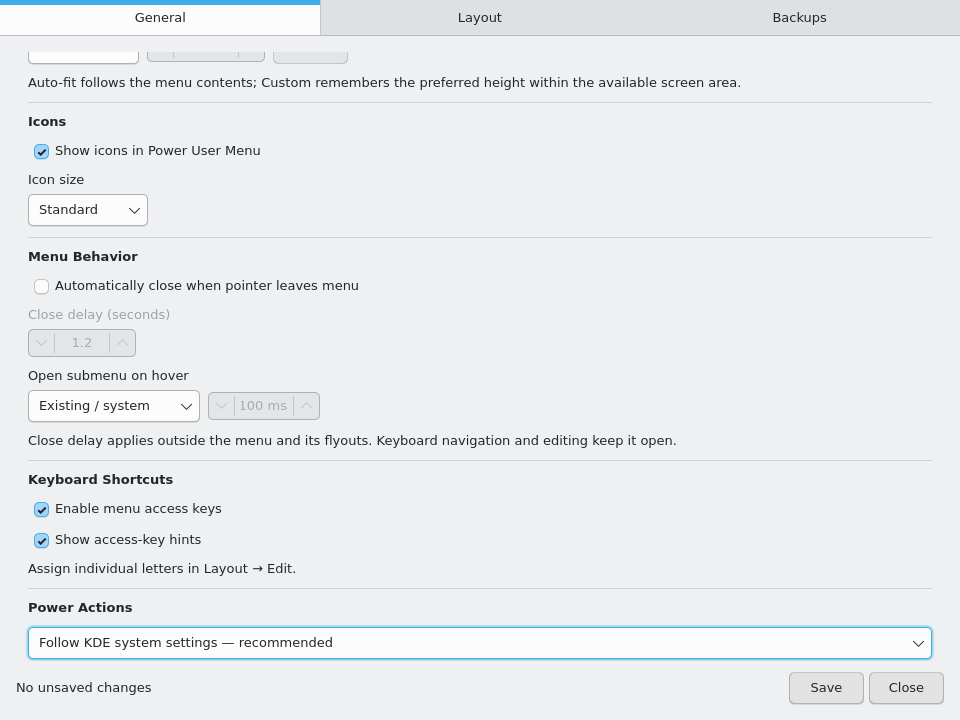
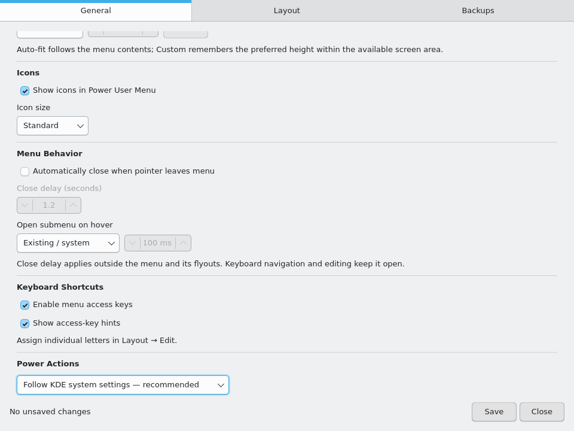
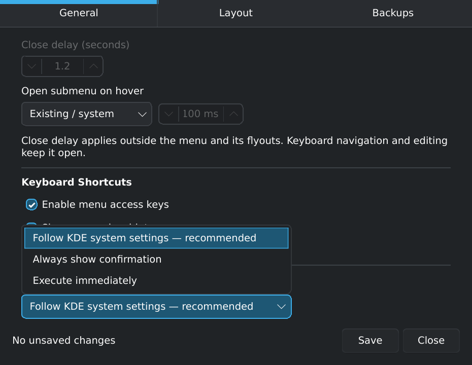

# 2.1.0 EZ installer — Phase 1 review

Baseline: RC2 `2f889df3e5b29f49611f8cf37f41f15e86cad7c1`. Packages use final
version **2.1.0**. This is staging for review, not an approved stable release.
No RC3, stable tag, release publication, default-branch merge or PR #10 change.
Repository cleanup and the brochure/documentation work remain later phases.

## Installation

Download the matching `OpenPowerMenu-EZ-v2.1.0-<distribution>-x86_64.zip` and
its `.sha256` from the **opm-2.1.0-phase1-<commit>** GitHub Actions artifact.
Actions staging requires a GitHub sign-in and is retained for 90 days; it is
not a permanent GitHub Release. The run and draft PR identify the exact commit.

```sh
sha256sum -c OpenPowerMenu-EZ-v2.1.0-Manjaro-x86_64.zip.sha256
unzip OpenPowerMenu-EZ-v2.1.0-Manjaro-x86_64.zip
cd OpenPowerMenu-EZ-v2.1.0-Manjaro-x86_64
bash install.sh
```

Use Debian13 or Kubuntu26.04 in the filename for those systems. Run as the
normal desktop user without sudo. `--check` checks the archive/runtime without
installation; `--yes` approves unattended setup without bypassing safeguards.
The package never installs system dependencies; it prints the relevant command
for the user to review and run separately. It works offline with the runtime
already present. There is no Python/compile step in installation.

The ZIP contains one complete sealed native bundle: backend, Configure editor,
standalone menu, Plasma widget/native input plugin, icon and transactional
installer. The native tar.gz bundles and Manjaro pacman package remain available.
Do not use the repository's legacy root `install.sh` for this native setup.
Root-entrypoint cleanup is explicitly deferred to Phase 2.

## Upgrade and recovery

The same command upgrades 1.0.1, RC1, RC2 or reinstalls 2.1.0. Existing settings,
custom commands, access keys, launcher visibility, shortcuts, panel layout and
recovery history are preserved. Keep Python/PySide6 for a 1.0.1 rollback.
No panel rewrite, widget recreation or automatic session restart occurs.
Plasma may retain the previous widget code until voluntary sign-out/sign-in.

Retain the extracted ZIP. Run `bash install.sh --recover` after interruption,
or `bash install.sh --rollback` to restore the preceding captured installation.
For removal, first remove only the OPM applet through Plasma, then run
`bash install.sh --uninstall`. Personal configuration/history remain intact.
The existing native installer commands remain available for recovery.

**Power actions may be immediate.** Existing preferences/custom commands keep
their behavior; new installations follow KDE. Never test power actions against
real services. Use the private fixture in `HELD-KEY-STABILIZATION.md`.

## Qualification and compatibility

| Target | Build and downloadable payload | Qualification |
| --- | --- | --- |
| Manjaro KDE Plasma 6 x86-64 | Manjaro-built ZIP, native bundle, pacman package | Independent runtime, installer, X11/Wayland widget keyboard and greeter |
| Debian 13 KDE Plasma 6 x86-64 | Debian-built ZIP and native bundle | Independent runtime, installer, desktop/X11/Wayland |
| Kubuntu 26.04 KDE Plasma 6 x86-64 | Ubuntu 26.04 + Plasma-built ZIP and native bundle | Independent runtime, installer, desktop/X11/Wayland |
| Arch 2026-09-27 | Compatibility regression only; no EZ binary claim | Existing independent package/runtime/keyboard/greeter job |

The staging job is gated on all ten qualification jobs. `QUALIFICATION.json`
records actual OS/library inventories, source, application audits, 16 keyboard
seats and the real greeter matrix using private mock final endpoints. No real
power operations occur. Runtime activation, native tests, QML, held keys and
Configure startup continue through the existing suites.

Installer tests cover clean install, same-version reinstall, actual released
1.0.1/RC1/RC2 upgrades and rollback, preserved custom data/panels/shortcuts,
interruption/recovery, removal, corrupt/missing payload, native input plugin,
missing dependencies, symlink/path refusal and home/extraction paths with spaces.
Both X11 and virtual KWin Wayland also install the extracted EZ payload, activate
the installed backend and Configure editor, capture its first frame, and uninstall
from a private profile. Independent minimal runtime images verify activation,
installation and rollback without Python on Debian/Ubuntu/Arch; Manjaro retains
its distro-required Python without PySide6. A subsequent image adds the actual
Plasma packages and exercises the extracted EZ wrapper offline. These full
Plasma images include distro Python dependencies but no PySide6 or compilers.

The Power Actions control now uses its measured natural width, bounded by its
parent. GUI tests exercise 620/960/1280 logical-pixel windows, real popup contents,
keyboard selection and saved enum values. `native/tests/editor-appearance.sh`
captures the genuine UI under Breeze Light/Dark at scale 1/1.5/2 in private
Xvfb profiles. Screenshots/evidence are in the desktop artifacts. No generated
mockups or physical workstation screenshots are used.

The collector verifies exact source equality, sealed native bundle contents,
package/bundle equivalence, then deterministically recreates each EZ ZIP from
its matching qualified native bundle and the committed wrapper/docs. ZIPs,
source/native archives and reports have SHA-256 checksums.

## Review boundary

Physical installer acceptance is pending. Container/virtual-desktop checks do
not prove hardware/theme/physical shortcut behavior. X11 translucent-panel
ghosting and minor responsiveness issues remain deferred. Wayland's deliberate
fail-closed behavior for releases outside OPM is unchanged. After reviewing the
staged installers and dropdown screenshots, approve Phase 1 before cleanup.
Stable publication requires a later explicit approval after all phases.

## Dropdown comparison

Genuine native UI, private Debian 13 Xvfb fixture. The before capture uses RC2's
unchanged full-width QML; after uses the Phase 1 natural width. Both light views
use 960×720 logical pixels and the same menu content. The narrow dark popup is
620×480 at 150% scaling. Raw full-resolution captures are linked below.

| RC2 layout | 2.1.0 preparation |
| --- | --- |
| [](images/phase1/power-before.png) | [](images/phase1/power-after.png) |

[](images/phase1/power-dark-narrow-150.png)

Capture: build the native GUI test target, then run
`sh native/tests/editor-appearance.sh <build>/native/native-editor-gui-tests <output>`.
The harness installs the actual Breeze color scheme into its own temporary
configuration before constructing QGuiApplication and asserts the dark/light
window palette. No desktop settings are changed. Power entries are never invoked.

## Changed-file inventory

27 files differ from RC2:

- `.dockerignore`
- `.github/workflows/tests.yml`
- `RELEASE-NOTES-v2.1.0.md`
- `docs/EZ-INSTALLER-PHASE1.md`
- `docs/images/phase1/power-after.png`
- `docs/images/phase1/power-before.png`
- `docs/images/phase1/power-dark-narrow-150.png`
- `native/VERSION`
- `native/packaging/PKGBUILD`
- `native/packaging/README-EZ.md`
- `native/packaging/README.md`
- `native/packaging/bundle.cmake.in`
- `native/packaging/ez-install.sh.in`
- `native/packaging/prepare-ez.py`
- `native/qml/Main.qml`
- `native/tests/editor-appearance.sh`
- `native/tests/editor.Dockerfile`
- `native/tests/editor_gui_test.cpp`
- `native/tests/ez-desktop-smoke.sh`
- `native/tests/package-runtime-smoke.sh`
- `native/tests/packaging.Dockerfile`
- `native/tests/packaging.py`
- `native/tests/pacman.Dockerfile`
- `native/tests/plasma_popup.py`
- `scripts/prepare-native-release.py`
- `scripts/stage-native-ez.py`
- `tests/test_ez_package.py`
