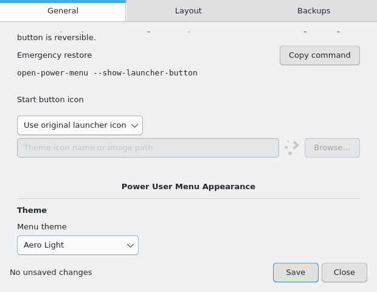
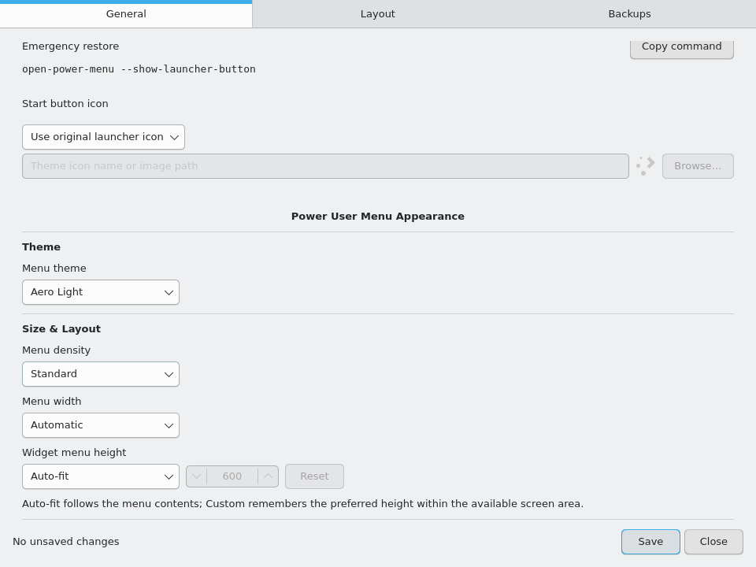

# OPM 2.1 startup and editor regression investigation

Starting source: `5d2be39e76918403741595ea91b7ed121b8a110e`.
Comparison baseline: `b3e3d8a1c11eacad8815f7a8b158e43ddf4837fc`.
Development branch: `feature/native-architecture-v1.1`; PR #10 remains draft.
This is a development candidate, not release or physical acceptance.

## Findings and corrections

### First opening after login

Reproduced in actual Plasma 6.3.6 / Qt 6.8.2 on a private D-Bus session and
virtual display, using a backend that refuses all command execution. Both
baseline commits expand the popup before GetMenu completes. Their first
opening showed 60 logical pixels of content (68 including theme padding),
then grew to 452 (460 including padding) when twelve entries arrived.
Preferences arrived independently. Subsequent openings briefly added and then
removed the loading-status row. Thus this startup defect predates the grip.
A permanently stuck minimum-size window on the user's Manjaro session has not
been reproduced; the virtual session corrected itself after the reply.

First-frame assertions subsequently reproduced a second initialization issue:
Plasma's host item could still be 375 pixels tall while the native window and
OPM's preferred content height already required 404. This could clip the first
paint. The full representation now follows the actual window's content rectangle
after attachment, rather than the host's delayed resize events. Only OPM's own
item loses its fill anchors; panel/container dimensions are not written, and
compositor constraints still apply through the actual window size.
Content is also bounded by its requested dimensions. A supplemental left-panel
test caught Plasma changing theme padding from 12 to 8 pixels while its outer
window still had the earlier size, briefly stretching the menu by four pixels.
That extra space can no longer stretch OPM's content. The native decoration's
own transition remains controlled by Plasma and is a physical acceptance check;
this does not establish that every compositor/theme frame is invariant.

The opening transaction now waits for launcher closure, menu contents, and
preferences. Existing bounded capability discovery completes before initial
exposure. It creates the full representation while hidden, drains QML bindings,
forces the row positioner to lay out, and then expands. After native attachment
it binds the content rectangle and polishes its layout before painting. There
is no startup sleep or new timer. A later launcher activation or toggle cancels preparation.
The ordinary preference poll shares an outstanding request, so a reply slower
than five seconds cannot be continually superseded by newer polls.

Visible model and font changes still drive natural height. Equal minimum,
preferred, and maximum bounds continue to defeat Plasma's cached popup size.
Custom height remains a preference; screen clamping and startup layout never
write it. Existing rows stay visible during an ordinary refresh, without adding
an unnecessary loading row.

### Native Configure

The physical report was clarified to “fails to open”; the Basic invocation
opened an interface without the new controls. Neither the executable path nor
its version/error output was supplied. The exact physical launch failure is
**unresolved**, not attributed to a guessed QML failure.

The current native editor loads with both Basic and KDE desktop controls in the
isolated environment. Two additional defects were reproduced and corrected:

- Breeze commits formatted SpinBox text on focus changes. The hover field
  displayed `600 ms` but parsed it as a bare number and fell back to 100.
  Both the millisecond field and decimal-seconds field now have matching parsers.
- The Layout page's single long footer row imposed a 635-pixel minimum on other
  pages. At the 620-pixel window minimum, the Save/Close row extended beyond the
  window. Wrapping that row and bounding the page stack fixes this. Appearance
  label/control pairs deliberately stack at narrow widths; compound height and
  hover controls stay together. Content-width ComboBoxes and all requested
  Appearance sections remain, including Aero Light.

GUI tests use real dropdown clicks and wait for popup open/close transitions.
The test driver's previous assumption that every style labels its standard
button exactly `Open` was wrong: KDE uses `Open...`. This was a harness defect,
not a broken import command. Breeze also emits upstream ButtonBackground
warnings during fallback file dialogs; diagnostics remain enabled and the full
import/export/recovery interaction now passes.

Pacman installs a **staged bundle**. Updating that package alone does not update
an existing per-user application. `open-power-menu-native-setup`, run by the
ordinary desktop user, performs the transactional per-user update. The native
CLI dispatches `--edit` to the editor in that per-user directory. This is a
plausible explanation for seeing the old editor, not confirmation of the user's
installed path. Plasma's cached QML cannot explain an old editor in a newly
launched separate process. Keep PATH/build identity as a physical acceptance
check; do not delete configuration or manually replace individual binaries.

### Resize grip

Real X11 pointer movement against the unmodified `5d2be39` grip was recorded at
roughly 45 ms intervals, including reversals and releases. Height and position
tracked the pointer; oscillation was **not reproduced** there. This does not
establish reliable physical Wayland or edge/scaling behavior.

A rejected SetMenuHeight request did reproduce misleading state: the frontend
switched to Custom before the reply and retained it until a later successful
preference refresh. Review also confirms that the grip saves the
runtime-clamped fitted height and changes strict popup size constraints on every
pointer move. Bottom placement consequently moves the whole native window during
the interaction. No claim is made that this proves the physical glitch's cause.

The new grip and optimistic frontend save path are removed. General → Appearance
retains Auto-fit, explicit Custom height, and Reset. This avoids shipping the
reported unreliable interaction. Native border resizing stays constrained so
cached/compositor geometry cannot silently become a preference. The additive
SetMenuHeight backend method remains for compatibility with an already-loaded
older frontend; its validation/storage tests remain enabled.

### Entry movement and themes

LayoutEditor and its drag algorithm are unchanged. Its actual Qt pointer tests
cover reordering, cancellation, entering two submenu levels, moving back out,
whole-subtree movement, spring navigation and scrolling; identity preservation
checks pass. No entry-drag regression was reproduced.

Native, Aero Dark (`appearance: "aero"`) and Aero Light are covered in the native
standalone tests and rendered QML tests. The real Plasma X11 fixture additionally
hovers into a flyout in each theme, checks its theme/colors and stable parent
height, and captures screenshots containing enabled, disabled and hovered rows.
Wayland startup uses real KWin/Plasma windows with applet activation; it does not
claim physical pointer injection into the Wayland seat.

## Repeatable qualification

`native/tests/plasma_startup.py` is included in the existing native-editor CI job.
It copies/instruments the widget into disposable profiles, allocates its own
Xvfb display or virtual KWin, and creates a private bus. It records timestamps
for backend requests/replies, entries, preferences, natural/preferred/minimum/
maximum dimensions, actual content/window size and visibility. Every first
visibility event must already have the complete model and saved preferences.
The driver waits for a painted panel and a fully hidden previous popup; Wayland
activation follows state transitions rather than fixed timers. First rendered
frames must also have the correct content height. Failure diagnostics are
printed into CI logs as well as saved in the disposable profile. No backend
write or launch method is accepted.

Eight scenarios each run twice (fresh isolated startup and owned shell restart),
with two openings per phase: **32 checked exposures**, including first-frame
content assertions. The ready X11 case also passed three concurrent repeat runs
(12 additional openings) against the exact CI dependency image. They include default
preferences, custom preferences, both response orders, a 5.6-second preference
reply crossing the poll interval, a ready backend, all densities, 1024×640,
1280×800 and 1600×1000 displays, and Wayland with two outputs at 125% scaling.
The X11 scale/output parameters do not emulate fractional scaling or multiple
X screens; those checks belong to the virtual Wayland cases.
The matrix includes a left-panel case on both platforms. Supplemental top/right
panel probes also passed, using the same driver against the final geometry code
before the additional content bounds were applied.

| Case, on X11 and Wayland | Natural content | Preferred content | Actual window at first and later exposure |
| --- | ---: | ---: | ---: |
| Standard, Auto-fit | 452 | 452 | 460 |
| Comfortable, Custom 460 | 548 | 460 | 468 |
| Compact, Auto-fit | 404 | 404 | 412 |

Local validation before CI:

- Python on the final source: **494 passed, 8 optional skips, 18 subtests**.
- Native CTest: **8/8**; KDE-style editor GUI rerun: **passed**. Editor interaction
  covers 620×480, 960×720 and 1280×900, Save/reopen, reset, keyboard scrolling,
  personal commands, Undo/Redo, import/export and recovery.
- D-Bus contracts: **15/15**.
- Installer/rollback transactions, including exact released 1.0.1: **10/10**.
- Standalone X11: **49 passed, one cross-process focus-test skip**;
  virtual KWin Wayland: **50/50**, both one output and two outputs at 125%.
- Sealed package rebuilt with crash hooks off; installation, editor startup,
  activation, reinstall, uninstall and rollback passed in the runtime image
  without Python, PySide6 or a compiler.

The final push and PR CI runs must pass all eight jobs before presenting a
Manjaro testing artifact. CI links, final SHA and artifact identity are recorded
in the PR qualification update and delivery report; they are not inferred from
an older commit's green run.

Rendered editor evidence:

## Physical acceptance still required

Use a disposable installation/profile first. Never run power actions as tests.
A virtual fresh KWin/Plasma session is not a real PAM login or a physical GPU test.

- Establish `type -a open-power-menu`, the resolved executable and editor payload.
  Confirm the new Appearance sections and Aero Light in both normal and Basic
  invocations. Record terminal diagnostics if the normal invocation still fails.
- After complete logout/login chosen by the tester, open once immediately and
  once after backend readiness. Compare first, second and later dimensions in
  Auto-fit and Custom with standard/compact/comfortable density and saved icons.
- Repeat with a user-chosen shell restart; compare with complete login, without
  relying on reopening to correct geometry. Record backend/model/geometry times.
- Change Custom height, save, reopen, change density, reduce/restore work area,
  and reset Auto-fit. Confirm the saved Custom number survives screen clamping
  and Auto-fit never overwrites it. There should be no header resize grip.
- Check top, bottom, left and right panels; physical X11 and Wayland; fractional
  scaling and mixed-monitor work areas. Confirm no startup shrink/grow flicker.
- Check entry reordering into/out of nested groups and spring-loaded Go Back;
  verify no missing, duplicated or changed commands. Check 500 ms pointer
  dismissal, focus return and all themes in main, nested and standalone menus.
- Confirm personal 1.0.1 settings, Save/Cancel and Undo/Redo after upgrade and
  rollback. No release acceptance is implied by CI or this report.
