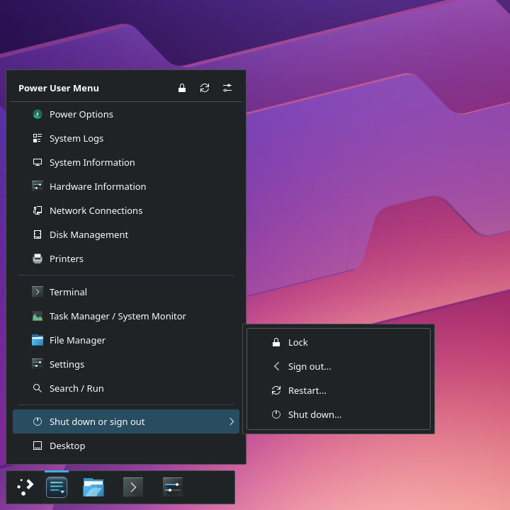
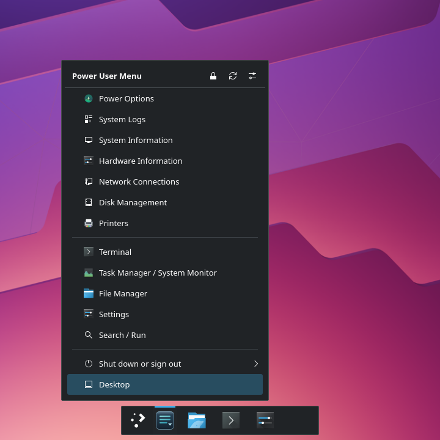
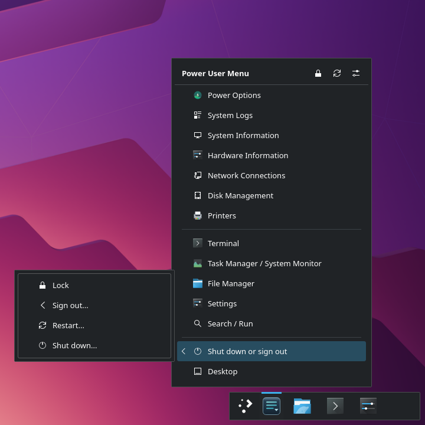
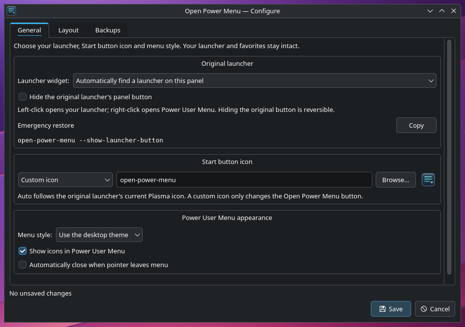
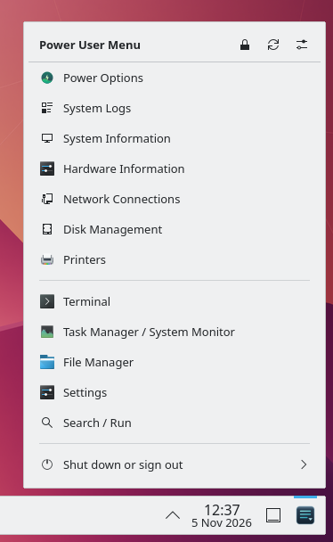
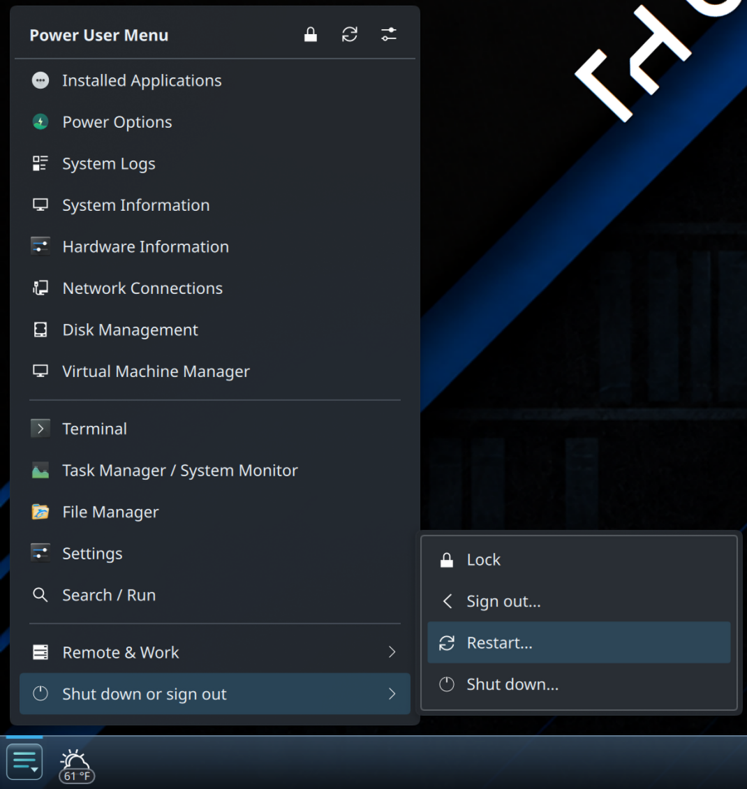
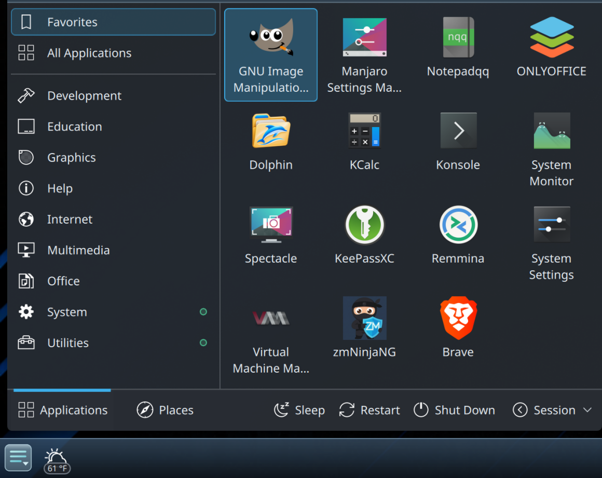
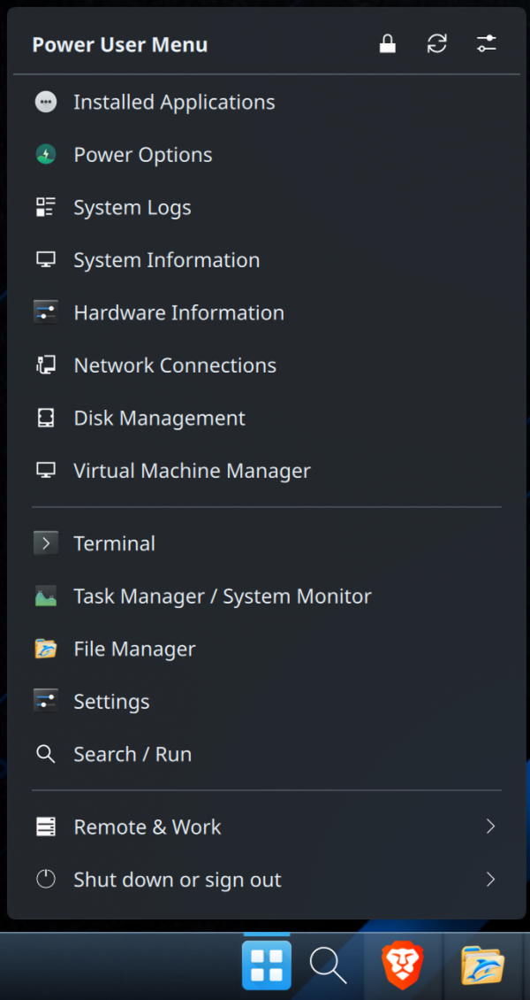

# Screenshot gallery

## Put it where you prefer

| Left side | Center | Right side |
| --- | --- | --- |
|  |  |  |

The original application launcher sits beside OPM. Left-click OPM for your
launcher, or right-click for the Power User Menu. Select an image to view it
at full size.

**Configure** — Choose your launcher, appearance and automatic closing preference.

## More ways to make it yours

**Power User Menu** — Quick access to system tools and applications.

**Submenus** — Organized commands with adaptive flyouts.

**Your launcher** — Keep your familiar applications and favorites.

**One button, both menus** — Choose the launcher arrangement that suits your panel.

[Appearance and menu preferences](../../README.md#configure-your-menu) ·
[Capture and release review](../RELEASE-1.0.1.md#screenshot-provenance) ·
[Earlier capture notes](../MENU-FLYOUT-UX.md#screenshots)
