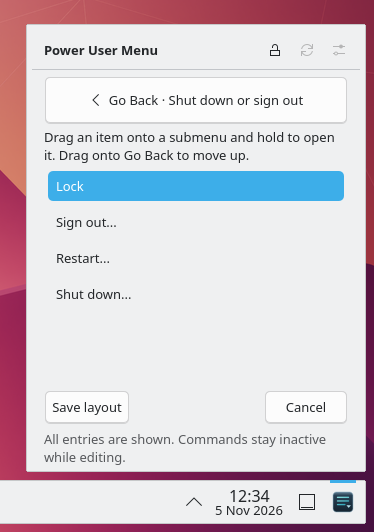
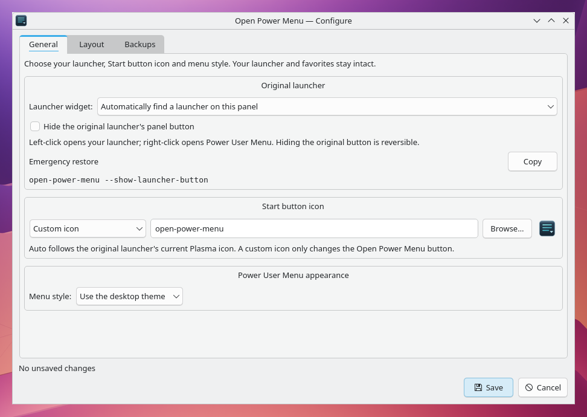
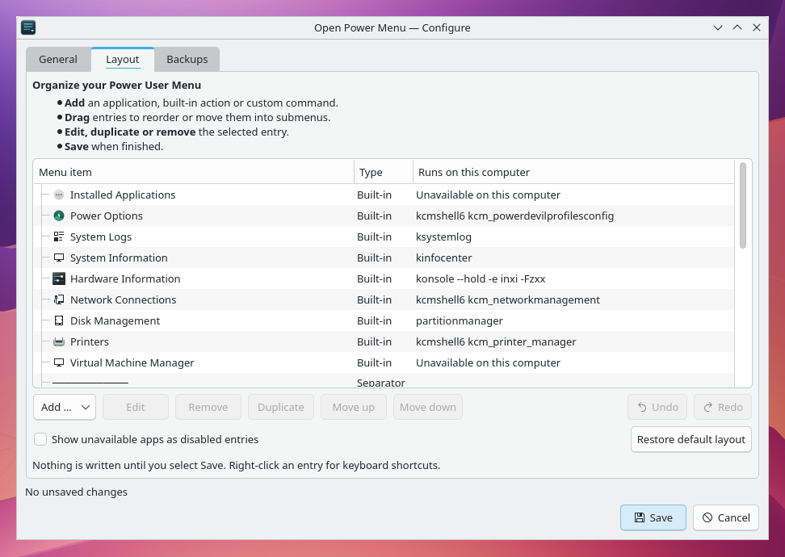
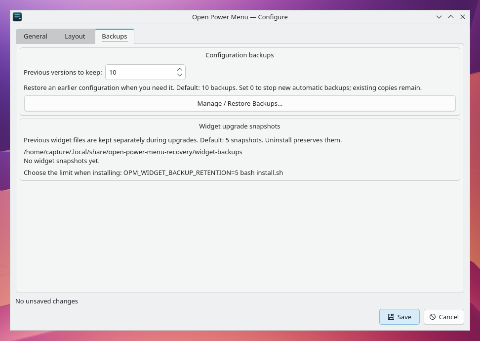

# Open Power Menu screenshot gallery

These are actual captures of the running application on **2026-11-05**.
The PNGs preserve the captured pixels: no generated UI, compositing, retouching
or resizing. Only the screen region supplied to the capture API varies.

## Power User Menu

Right-clicking OPM opens the menu above its panel button. The default layout
hides unavailable actions, so the entries reflect the installed tools.


## Normal-use submenu

Hovering **Shut down or sign out** opens a native flyout. It opens to the left
here because OPM is at the right end of the panel. No power action was invoked.


## In-menu editing

The unlocked editor shows **Go Back · Shut down or sign out**, its entries and
**Save layout / Cancel** in one popup. This is a stationary editing view; it
does not depict a drag in progress. Go Back and Cancel were exercised, and the
demo draft was discarded.



## Configure

**General** controls the launcher, original-button visibility, OPM icon and
appearance. The emergency restore command is separately selectable and copyable.



**Layout** lists entries and their resolved commands. In this untouched demo
profile, no item is selected and the undo history is empty.



**Backups** keeps configuration history separate from widget upgrade snapshots.
This fresh profile has no widget snapshots yet.



## Existing application launcher

Left-clicking OPM at the far right opens the existing **Kickoff** launcher at
its original location on the left. Its original button remains visible. The
wide capture preserves both buttons and the launcher in a single screen state.


## Capture record

| Detail | Value |
| --- | --- |
| Application source | [`ac9e057a8d67a54d2254bd06c640d702df5d34a3`](https://github.com/BB7Networks/Open-Power-Menu/tree/ac9e057a8d67a54d2254bd06c640d702df5d34a3), main after PR #6; version 0.4.17 |
| Distribution | Debian GNU/Linux 13 (trixie), disposable Docker profile named `capture` |
| Desktop | Plasma 6.3.6, KWin X11, native Kickoff bundled with Plasma 6.3.6 |
| Qt / PySide6 | Qt 6.8.2; Debian PySide6 package 6.8.2.1-4 |
| Display | Xvfb, 1440 × 900, 24-bit color, 100% scale; Qt Quick software rendering, compositing disabled |
| Appearance | Breeze Light and Breeze icons, OPM's **Use the desktop theme** setting |
| Panel | Bottom edge; Kickoff at the left, OPM at the right; original launcher button visible |
| Menu configuration | Default menu; custom button icon `open-power-menu` to distinguish OPM from Kickoff |
| Installation | Actual `scripts/install-core.sh`; its documented file-copy fallback was used because `kpackagetool6` was absent |
| Isolation | Disposable user home and session D-Bus; container network disabled during captures |

The application and widget came from the source revision above without UI code
changes. The setup installed Konsole, Dolphin, System Settings, KSystemLog,
Partition Manager, Info Center, System Monitor and KDE Print Manager. Session
setup used `XDG_CURRENT_DESKTOP=KDE`, `XDG_SESSION_TYPE=x11`,
`XDG_MENU_PREFIX=plasma-`, `dbus-run-session`, `kwin_x11` and `plasmashell`.

Screens were captured directly through Qt's `QScreen.grabWindow`, equivalent to:

```python
from PySide6.QtGui import QGuiApplication

app = QGuiApplication([])
screen = app.primaryScreen()
screen.grabWindow(0, x, y, width, height).save(filename)
```

All coordinates below are in the 1440 × 900 virtual desktop. Each PNG's
dimensions equal its capture region; no later image transformation was applied.

| File | Region `(x, y, width, height)` |
| --- | --- |
| `power-user-menu.png` | `(1066, 292, 374, 608)` |
| `submenu-flyout.png` | `(804, 292, 636, 608)` |
| `in-menu-editing.png` | `(1066, 368, 374, 532)` |
| `configure-general.png` | `(224, 30, 972, 690)` |
| `configure-layout.png` | `(224, 30, 972, 690)` |
| `configure-backups.png` | `(224, 30, 972, 690)` |
| `application-launcher.png` | `(0, 292, 1440, 608)` |

## Scope and future captures

These captures demonstrate the displayed UI and simple navigation in this
virtual X11 session. They do not establish physical Wayland drag behavior,
AppGrid integration, multi-monitor placement or native shortcut lifecycle.
The minimal capture session did not include the global-shortcut daemon or a
system D-Bus service; Meta+X and power actions were not acceptance-tested here.
The [desktop acceptance matrix](../TESTING.md) still applies before release.

Useful additions from full desktop sessions include AppGrid Center 1.9.6,
scaled and vertical panels, the installed-app picker, backup restoration and
external-edit conflict recovery. Use a clean demo profile and record versions,
session type, launcher, scale and panel position with each new capture.
